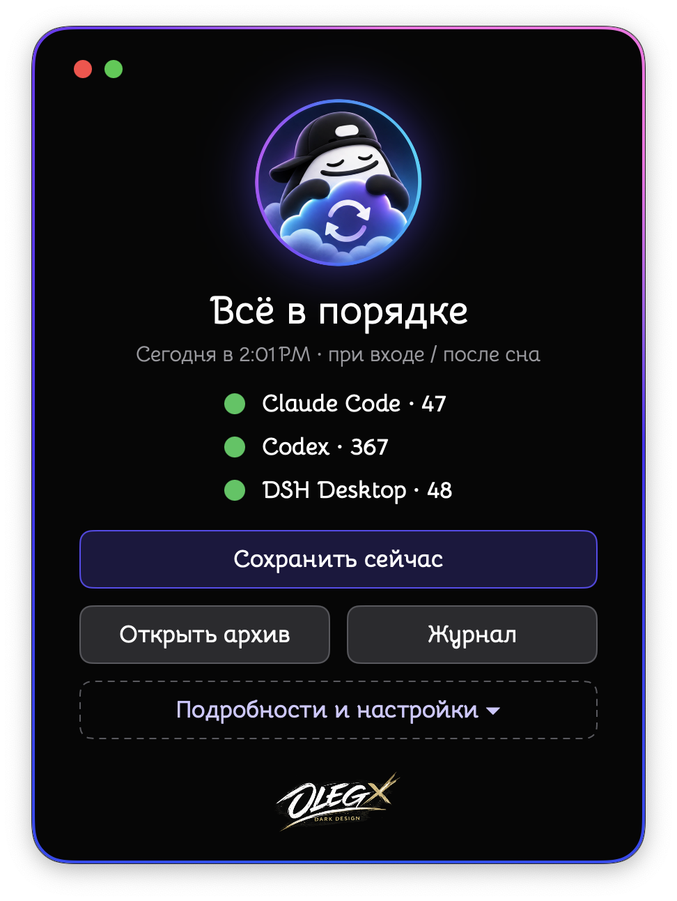
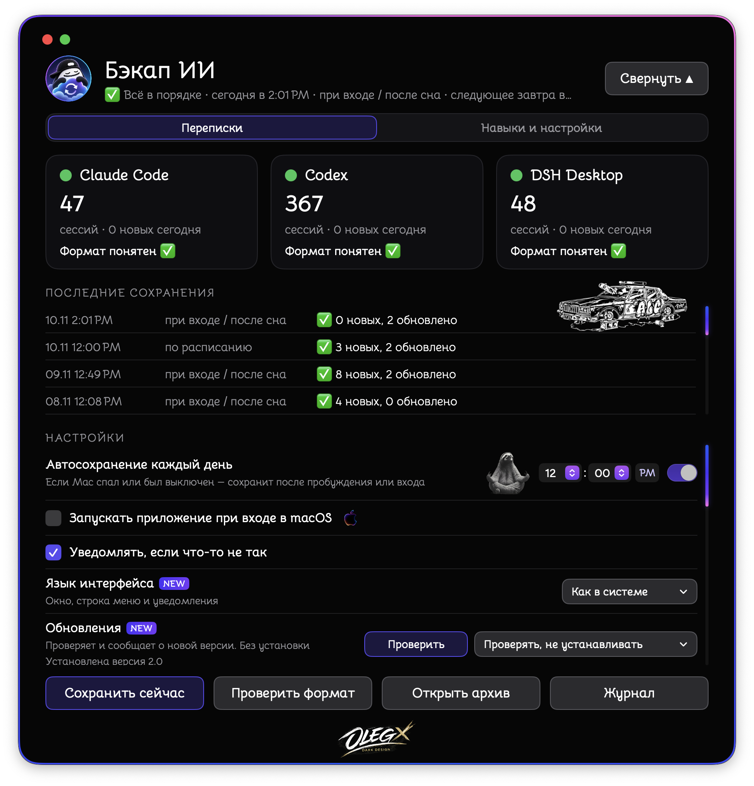
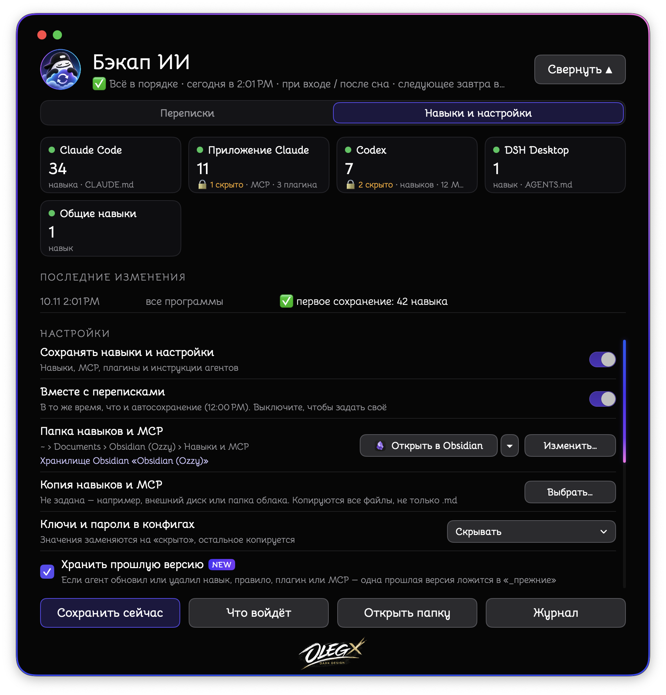

<p align="center">
  
  
  
</p>

# 💾 AI Chat Backup (Бэкап ИИ)

[Русский](README.md) · English · [中文](README.zh.md) · [日本語](README.ja.md) · [हिन्दी](README.hi.md)

> 🧠 Your AI chats, agent skills and settings — in plain files. On your Mac. Offline.

**⬇️ [Download the app for Intel and Apple Silicon (DMG)](https://github.com/OzzyLabz/ozzy-ai-chat-backup/releases/latest/download/Ozzy-AI-Chat-Backup.dmg)**

---

## ⚡ In short

- 📝 Saves chats from Claude Code, Codex, DSH Desktop, Hermes, VS Code (Copilot Chat), claude.ai and ChatGPT.
- 🧰 Saves the skills, MCP servers, plugins and instructions of your AI agents — so you can reinstall them on any agent, even if they have no source on GitHub.
- 📂 Sorts everything into folders — read it in Obsidian, any Markdown editor or right in Finder.
- ⏰ Saves once a day on its own, even if your Mac was asleep.
- 🌍 Interface in 5 languages: Русский, English, 中文, 日本語, हिन्दी.
- 🔄 Finds new versions and can update itself — no need to visit GitHub.
- 🔒 Sends nothing anywhere.

Only the text of chats is saved. Images and other attachments are not copied: the file gets a marker in their place, such as `[image]`.

---

## 🧩 Features

- ⏰ Daily autosave at the time you choose and when you log in to macOS. If your Mac was asleep or off, the save runs after it wakes up. Time follows macOS (12- or 24-hour) and can be typed in.
- ➕ New messages are appended to the end of an already saved file. What was written before never changes, and chats deleted in the AI app stay in the archive.
- 🧹 Service inserts (system prompts, settings snapshots, context-compaction summaries) are left out — only your messages and the model's replies.
- 🛟 If an AI app updates and changes its file format, AI Chat Backup saves the chat the fallback way and warns you in the window and the log. Errors and warnings in the history show "What happened / What to do" and buttons.
- 💽 A copy of the archive in a second folder, for example on an external drive.
- 🚪 "Open in …" button: the archive opens in the app you choose — Finder, Obsidian (if the archive is in a vault), VS Code, CotEditor, Nimble Commander, Terminal or any other — with that app's own icon.
- 🔔 A monthly reminder to download your chat export from claude.ai and ChatGPT.

---

## 🧰 Skills, MCP and plugins

The "Skills & settings" tab saves what you've equipped your AI agents with into a separate "Skills and MCP" folder (by default next to the chat archive in your Obsidian vault, or in Documents without Obsidian).

| Agent | What is saved | Status |
|---|---|---|
| Claude Code | skills, `CLAUDE.md`, `settings.json`, MCP, plugins | ✅ tested (plugins — from the docs) |
| Claude app | MCP servers, plugins | ✅ tested |
| Codex | skills, `AGENTS.md`, rules, `config.toml`, MCP, plugins and marketplaces | ✅ tested |
| DSH Desktop | skills, `AGENTS.md` | ✅ tested |
| Shared skills `~/.agents` | skills | ✅ tested |
| Hermes, Gemini CLI, Antigravity, Cursor, Windsurf, VS Code | skills, instructions, MCP, plugins and extensions | 🧪 built from the official docs, not tested on real data |
| Folders of your own (e.g. agent memory) | the whole folder | ✅ |

```
Skills and MCP/
├── Overview.md           ← what's there, version, which agents have it, where it came from, how to restore
├── Skills/               ← each skill once, an exact copy of its folder
├── MCP.md                ← each server once, with a ready settings block to paste
├── Plugins.md            ← by agent, with the source to reinstall from
├── Agent instructions/   ← CLAUDE.md, AGENTS.md, settings — by agent
├── My folders/
├── _previous/            ← one previous version of what an agent updated or removed
└── Change log.md
```

- 🔑 **Keys and passwords in configs** — your choice: hide them (replaced with `‹hidden›`), keep them as is, or don't save such files.
- ⛔ **Never copied:** sign-in files (`auth.json`, `.credentials…`, `.env`), plugin caches, `node_modules`, `.git`.
- 🎯 **What's installed in the agent is what counts.** Copies are exact; if you edit a copy, the next save makes it exact again.
- ⏱️ Saved together with the chats or at its own time. "Preview" shows what will be copied without writing anything.
- The window lists only agents found on your Mac; if one is installed in an unusual place, use "Add an app…".

Folder and file names follow the app language — in English they are as shown above.

---

## 🤖 Supported apps for chats

| App | Where chats come from | Status |
|---|---|---|
| Claude Code | files in `~/.claude/projects` | ✅ tested |
| Codex | files in `~/.codex/sessions`, `~/.codex/archived_sessions` and the history database | ✅ tested |
| DSH Desktop | compressed files in `~/.dsh/sessions` | ✅ tested |
| Hermes | database `~/.hermes/state.db` | 🧪 built from the official docs, not tested on real data |
| VS Code (Copilot Chat) | `chatSessions` folders in VS Code settings | 🧪 experimental: the format is not officially documented |
| claude.ai, ChatGPT | an export downloaded from the site (ZIP, folder or JSON) | 🧪 built from the export format, not yet tested on real exports; all conversation branches are saved |
| Cursor, Windsurf and others | your folders with `.md` or `.txt` exports | 📄 files are copied as is |

You can change the data path of any app in the window ("Sources → Change path…") or turn an app off. Only apps found on your Mac are listed; add one installed in an unusual place with "Add an app…".

⏳ Claude Code deletes chats older than 30 days by default. In the app you can choose 30 days, 1 year or 10 years. This changes one setting, `cleanupPeriodDays`, in `~/.claude/settings.json`; a copy of the file is saved next to it first.

---

## 🗃️ How the archive is organized

```
AI chat history/
├── Claude Code/
│   └── 2026-11-03/
│       └── Conversation title.md
├── Codex/
├── claude.ai/
└── Save log.md
```

The top of each file holds the date, time, project and session ID as properties Obsidian understands; the conversation follows. The "Save log" records when and how much was saved.

🌍 Service words in files (property names, markers, the log, the "Skills and MCP" folders) are written in the app language. If you switch languages, the app renames its own files, rewrites service lines in what's already saved and fixes links to them in your Obsidian vault. Folders you chose or named yourself are never touched.

🪨 **Obsidian.** The app doesn't need Obsidian. If Obsidian is installed, the archive goes by default into your last opened vault, in an "AI chat history" folder. The "Archive folder" row in settings shows which vault holds it. Without Obsidian, the same row has a link to the official download page. Obsidian is free; the app neither includes nor distributes it.

---

## 🌍 Languages

The interface, messages, notifications and menus are in Russian, English, Chinese, Japanese and Hindi. Choose the language in settings ("Interface language") or follow the system. After a language change the app restarts in the same place so that macOS menu items switch too.

🙏 The Chinese, Japanese and Hindi translations were made without native speakers. If you spot a mistake or an awkward phrase, write to 📧 [samo.zlo.spb@gmail.com](mailto:samo.zlo.spb@gmail.com) or open an issue on GitHub — I'll fix it.

---

## 🔄 Updates

In the "Chats" settings, the "Updates" row:

- **Update automatically** — checks, downloads and installs updates on its own;
- **Check, don't install** (default) — tells you about a new version and shows "What's new"; install whenever you like;
- **Turn off updates** — the app doesn't check for updates.

Updates are signed with the author's key: the app installs only genuine releases. Powered by [Sparkle](https://sparkle-project.org). Version 1.0 doesn't check for updates — download 2.0 manually once, and updates will come on their own after that.

---

## 🖥️ System requirements and testing status

- 💻 One `.app` contains code for Intel (`x86_64`) and Apple Silicon (`arm64`).
- 🍏 Minimum version: **macOS 13.0**.
- ✅ Tested on Intel with macOS 15: build, launch, saving chats and skills, 5 languages, updating from a local feed.
- 🧪 Not yet tested on Apple Silicon or older macOS versions.

---

## 📦 Installation and first launch

1. Download the DMG, open it and drag the app to Applications. In Finder its name follows the system language: "AI Chat Backup", "Бэкап ИИ" and so on.
2. ⚠️ The app is only ad hoc signed and not notarized by Apple. On first launch macOS may warn about an unidentified developer — open it via **System Settings → Privacy & Security**. Details: [Apple's guide](https://support.apple.com/guide/mac-help/open-a-mac-app-from-an-unknown-developer-mh40616/mac).
3. On first launch, choose a folder for the archive and click "Start". 🎉

Updating from 1.0? Just install 2.0 and launch it: settings, archive and schedule are kept. You can delete the old "Бэкап ИИ.app".

---

## 🚀 Usage

- 💾 **"Save now"** — save manually without waiting for the schedule.
- 📂 **"Open archive"** — open the archive in the app you chose.
- 📜 **"Log"** — see when and what was saved.
- ⚙️ **"Details and settings"** — two tabs: "Chats" (autosave time, launch at login, notifications, language, updates, archive and copy folders, sources, importing site exports) and "Skills & settings".

🌐 **Chats from claude.ai and ChatGPT.** Request a data export on the site:

- claude.ai (website or Claude Desktop): Settings → Privacy → Export data. The link arrives by email and works for 24 hours.
- ChatGPT: Settings → Data controls → Export data. The email may take a while (up to 7 days); the link works for 24 hours.

Drag the downloaded ZIP into the app window or click "Import export…". Importing again adds new chats; nothing old is lost. The same tip is in the app — the "How to download?" button.

---

## 🔒 Privacy

- 🏠 Everything happens on your Mac. The app has no analytics and doesn't send your data anywhere. It goes online only to check for updates (a version list file on GitHub), and you can turn that off. The "Download Obsidian" link just opens a page in your browser.
- 👀 The app only reads the files and databases of AI apps and never changes them. The one exception is the Claude Code retention setting, and only when you choose it.
- 🔑 Keys in configs are hidden by default; sign-in files are never copied.
- ☁️ If the archive or "Skills and MCP" sits in an Obsidian vault with sync turned on (Obsidian Sync, iCloud, etc.), or the copy is in a cloud folder, the data ends up in that cloud. That depends on your settings, not on the app.

---

## 🧰 Where the app keeps its data and how to turn it off

- Settings and state: `~/Library/Application Support/Бэкап ИИ/`.
- Schedule: `~/Library/LaunchAgents/com.ozzy.backup-ai.plist`; if skills are saved at their own time, also `com.ozzy.backup-ai.kit.plist`.

To turn it off completely: in the app, turn off "Auto-save every day" and "Back up skills & settings", untick "Open at login", then quit the app. The archive and "Skills and MCP" stay in place.

---

## 🚧 Limitations

- claude.ai and ChatGPT chats are available only through a site export.
- Cursor and Windsurf keep history in internal formats — the app takes only their `.md` export.
- Only what's still on disk can be saved: if an AI app has already deleted old chats, they can't be recovered.
- The last message of a conversation that's still going is saved on the next save.
- Skills and MCP are restored by hand, following the tips in `Overview.md`: the app never writes into agents' folders.

---

## 🛠️ Source and build

Source code is in `Sources/`, resources in `Resources/` (translations in `Resources/Lang/`), the update library in `Vendor/Sparkle`. Build: `RELEASE=1 ./build.sh` → `dist/AI Chat Backup.app` (Swift, `swiftc` for two architectures plus `lipo`, no Xcode project). Tested with Xcode installed. DMG: `./make-dmg.sh`. The `appcast.xml` update list is signed with Sparkle's tools ([Sparkle 2.10.1 release](https://github.com/sparkle-project/Sparkle/releases/tag/2.10.1)).

The bundled `zstd` decompressor is built from the official [facebook/zstd](https://github.com/facebook/zstd) 1.5.7 sources. Third-party components and their licenses: [THIRD_PARTY_NOTICES.md](THIRD_PARTY_NOTICES.md).

---

## ⚖️ License

Copyright (c) 2026 OzzyLabz. The original app code and documentation are distributed under a custom [Noncommercial Use License 1.0](LICENSE). Use, modification and distribution are allowed for noncommercial purposes only. Selling the app or using the covered materials to earn income or commercial benefit requires separate written permission. Third-party components keep their own licenses: [THIRD_PARTY_NOTICES.md](THIRD_PARTY_NOTICES.md).

---

## ✍️ Author

Idea, design and app: **Ozzy** 🥷🏾

---

## 📬 If something doesn't work 🤝

Found a bug, have an idea or want to say thanks — write:
📧 [**samo.zlo.spb@gmail.com**](mailto:samo.zlo.spb@gmail.com)

The same address is in the About window (the logo at the bottom of the app window), and when an error happens the app shows a "Write to the author" button.

To help find and fix the problem quickly, please include:

- 🪜 what you did and what went wrong — briefly, step by step;
- 📸 a screenshot of the error;
- 🍏 your macOS version (Apple menu → "About This Mac");
- 💻 your Mac model and chip: Intel or Apple Silicon (M1, M2, etc.);
- 🏷️ the app version (in settings, the "Updates" row);
- 🤖 which AI app it's about (Claude Code, Codex, etc.), if the error is related to one.
