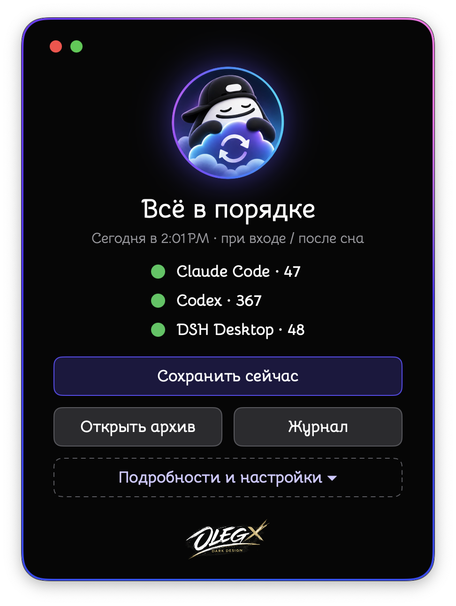
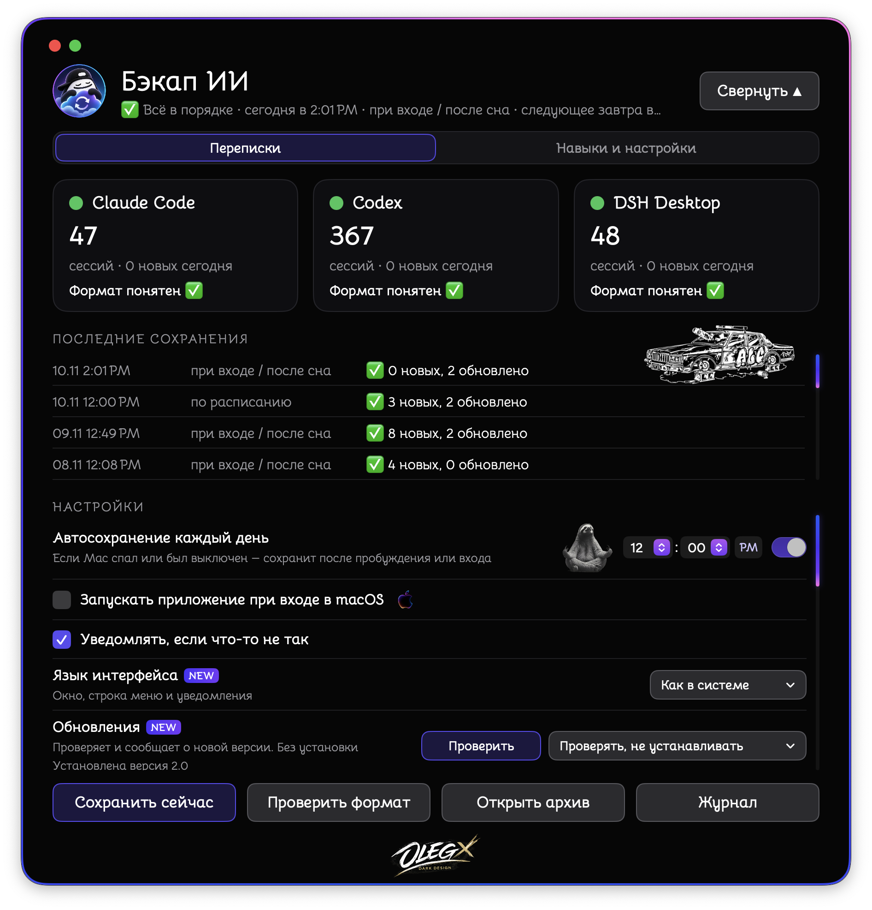
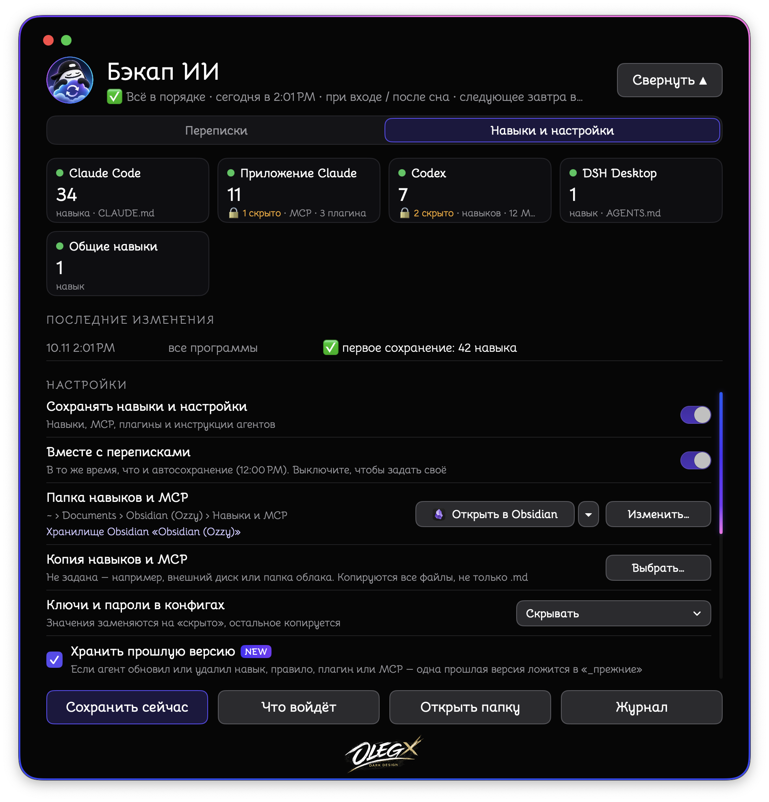

<p align="center">
  
  
  
</p>

# 💾 एआई चैट बैकअप (AI Chat Backup)

[Русский](README.md) · [English](README.en.md) · [中文](README.zh.md) · [日本語](README.ja.md) · हिन्दी

> 🧠 एआई के साथ आपकी चैट, एजेंटों के कौशल और सेटिंग्स — साधारण फ़ाइलों में। आपके Mac पर। बिना इंटरनेट के।

**⬇️ [Intel और Apple Silicon के लिए ऐप डाउनलोड करें (DMG)](https://github.com/OzzyLabz/ozzy-ai-chat-backup/releases/latest/download/Ozzy-AI-Chat-Backup.dmg)**

> 🙏 इस विवरण और ऐप का हिन्दी अनुवाद लेखक ने किया है, किसी मूल हिन्दी भाषी ने इसकी जाँच नहीं की है। अगर आपको कोई गलती या अटपटा वाक्य दिखे, तो 📧 [samo.zlo.spb@gmail.com](mailto:samo.zlo.spb@gmail.com) पर लिखें या GitHub पर issue खोलें — मैं ठीक कर दूँगा।

---

## ⚡ संक्षेप में

- 📝 Claude Code, Codex, DSH Desktop, Hermes, VS Code (Copilot Chat), claude.ai और ChatGPT की चैट सहेजता है।
- 🧰 एआई एजेंटों के कौशल, MCP सर्वर, प्लगइन और निर्देश सहेजता है — ताकि आप उन्हें किसी भी एजेंट में फिर से इंस्टॉल कर सकें, भले ही GitHub पर उनका कोई स्रोत न हो।
- 📂 सब कुछ फ़ोल्डरों में व्यवस्थित करता है — Obsidian, किसी भी Markdown एडिटर या सीधे Finder में पढ़ें।
- ⏰ दिन में एक बार अपने आप सहेजता है, भले ही Mac सो रहा हो।
- 🌍 इंटरफ़ेस 5 भाषाओं में: Русский, English, 中文, 日本語, हिन्दी।
- 🔄 नए संस्करण खुद ढूँढता है और GitHub पर गए बिना अपडेट हो सकता है।
- 🔒 कुछ भी कहीं नहीं भेजता।

चैट का केवल टेक्स्ट सहेजा जाता है। चित्र और अन्य अटैचमेंट कॉपी नहीं होते: उनकी जगह फ़ाइल में एक निशान होता है, जैसे `[छवि]`।

---

## 🧩 सुविधाएँ

- ⏰ आपके चुने समय पर और macOS में लॉगिन करते समय रोज़ अपने आप सहेजना। अगर Mac सो रहा था या बंद था, तो जागने के बाद सहेजा जाता है। समय macOS जैसा दिखता है (12 या 24 घंटे), और उसे हाथ से भी लिखा जा सकता है।
- ➕ नए संदेश पहले से सहेजी गई फ़ाइल के अंत में जुड़ते हैं। पहले लिखा हुआ नहीं बदलता, और एआई ऐप में हटाई गई चैट संग्रह में बनी रहती है।
- 🧹 ऐप के आंतरिक हिस्से (सिस्टम संकेत, सेटिंग्स के स्नैपशॉट, संदर्भ छोटा करते समय के सारांश) संग्रह में नहीं जाते — केवल आपके संदेश और मॉडल के उत्तर।
- 🛟 अगर कोई एआई ऐप अपडेट होकर अपनी फ़ाइलों का फ़ॉर्मैट बदल दे, तो एआई चैट बैकअप चैट को वैकल्पिक तरीके से सहेजता है और विंडो व लॉग में बताता है। इतिहास में त्रुटियों और चेतावनियों के साथ “क्या हुआ / क्या करें” और बटन दिखते हैं।
- 💽 संग्रह की प्रति दूसरे फ़ोल्डर में, जैसे बाहरी डिस्क पर।
- 🚪 “… में खोलें” बटन: संग्रह आपके चुने ऐप में खुलता है — Finder, Obsidian (अगर संग्रह उसके वॉल्ट में है), VS Code, CotEditor, Nimble Commander, टर्मिनल या कोई और — उसी ऐप के आइकन के साथ।
- 🔔 claude.ai और ChatGPT से चैट का निर्यात डाउनलोड करने की महीने में एक बार याद दिलाना।

---

## 🧰 कौशल, MCP और प्लगइन

“कौशल और सेटिंग्स” टैब आपके एआई एजेंटों में जोड़ी गई चीज़ों को एक अलग “कौशल और MCP” फ़ोल्डर में सहेजता है (डिफ़ॉल्ट रूप से Obsidian वॉल्ट में चैट संग्रह के बगल में, Obsidian न हो तो “दस्तावेज़” में)।

| एजेंट | क्या सहेजा जाता है | स्थिति |
|---|---|---|
| Claude Code | कौशल, `CLAUDE.md`, `settings.json`, MCP, प्लगइन | ✅ जाँचा गया (प्लगइन — दस्तावेज़ के अनुसार) |
| Claude ऐप | MCP सर्वर, प्लगइन | ✅ जाँचा गया |
| Codex | कौशल, `AGENTS.md`, नियम, `config.toml`, MCP, प्लगइन और मार्केट | ✅ जाँचा गया |
| DSH Desktop | कौशल, `AGENTS.md` | ✅ जाँचा गया |
| साझा कौशल `~/.agents` | कौशल | ✅ जाँचा गया |
| Hermes, Gemini CLI, Antigravity, Cursor, Windsurf, VS Code | कौशल, निर्देश, MCP, प्लगइन और एक्सटेंशन | 🧪 आधिकारिक दस्तावेज़ के अनुसार बनाया गया, असली डेटा पर नहीं जाँचा गया |
| आपके अपने फ़ोल्डर (जैसे एजेंटों की मेमोरी) | पूरा फ़ोल्डर | ✅ |

```
कौशल और MCP/
├── अवलोकन.md            ← क्या है, संस्करण, किन एजेंटों में है, कहाँ से आया, वापस कैसे लाएँ
├── कौशल/                ← हर कौशल एक बार, फ़ोल्डर की सटीक प्रति
├── MCP.md               ← हर सर्वर एक बार, चिपकाने के लिए तैयार सेटिंग्स ब्लॉक के साथ
├── प्लगइन.md            ← एजेंट के अनुसार, फिर से इंस्टॉल करने के स्रोत के साथ
├── एजेंट निर्देश/        ← CLAUDE.md, AGENTS.md, सेटिंग्स — एजेंट के अनुसार
├── मेरे फ़ोल्डर/
├── _पिछले संस्करण/       ← एजेंट ने जो अपडेट किया या हटाया, उसका एक पिछला संस्करण
└── बदलाव लॉग.md
```

- 🔑 **कॉन्फ़िग में कुंजियाँ और पासवर्ड** — आपकी पसंद: छिपाएँ (`‹छिपा हुआ›` से बदलें), जैसे हैं वैसे सहेजें, या ऐसी फ़ाइलें न सहेजें।
- ⛔ **कभी कॉपी नहीं होते:** साइन-इन फ़ाइलें (`auth.json`, `.credentials…`, `.env`), प्लगइन कैश, `node_modules`, `.git`।
- 🎯 **मुख्य वही है जो एजेंट में इंस्टॉल है।** प्रतियाँ सटीक होती हैं; अगर आप प्रति बदलें, तो अगली बार सहेजने पर वह फिर सटीक हो जाती है।
- ⏱️ चैट के साथ या अपने अलग समय पर सहेजा जाता है। “पूर्वावलोकन” बिना कुछ लिखे दिखाता है कि क्या कॉपी होगा।
- विंडो में केवल Mac पर मिले एजेंट दिखते हैं; अगर कोई एजेंट असामान्य जगह पर है, तो “ऐप जोड़ें…” का उपयोग करें।

फ़ोल्डर और फ़ाइलों के नाम ऐप की भाषा के अनुसार होते हैं — हिन्दी में ऊपर जैसे।

---

## 🤖 चैट के लिए समर्थित ऐप

| ऐप | चैट कहाँ से ली जाती है | स्थिति |
|---|---|---|
| Claude Code | `~/.claude/projects` की फ़ाइलें | ✅ जाँचा गया |
| Codex | `~/.codex/sessions`, `~/.codex/archived_sessions` की फ़ाइलें और इतिहास डेटाबेस | ✅ जाँचा गया |
| DSH Desktop | `~/.dsh/sessions` की संपीड़ित फ़ाइलें | ✅ जाँचा गया |
| Hermes | डेटाबेस `~/.hermes/state.db` | 🧪 आधिकारिक दस्तावेज़ के अनुसार बनाया गया, असली डेटा पर नहीं जाँचा गया |
| VS Code (Copilot Chat) | VS Code सेटिंग्स में `chatSessions` फ़ोल्डर | 🧪 प्रायोगिक: फ़ॉर्मैट आधिकारिक रूप से वर्णित नहीं है |
| claude.ai, ChatGPT | साइट से डाउनलोड किया गया निर्यात (ZIP, फ़ोल्डर या JSON) | 🧪 निर्यात फ़ॉर्मैट के अनुसार बनाया गया, असली निर्यात पर अभी नहीं जाँचा गया; बातचीत की सभी शाखाएँ सहेजी जाती हैं |
| Cursor, Windsurf और अन्य | `.md` या `.txt` निर्यात वाले आपके फ़ोल्डर | 📄 फ़ाइलें जैसी हैं वैसी कॉपी होती हैं |

किसी भी ऐप के डेटा का पथ विंडो में बदला जा सकता है (“स्रोत → पथ बदलें…”) या ऐप बंद किया जा सकता है। सूची में केवल मिले हुए ऐप दिखते हैं; असामान्य जगह पर इंस्टॉल ऐप “ऐप जोड़ें…” से जोड़ें।

⏳ Claude Code डिफ़ॉल्ट रूप से 30 दिन से पुरानी चैट हटा देता है। ऐप में 30 दिन, 1 वर्ष या 10 वर्ष चुन सकते हैं। इससे `~/.claude/settings.json` की केवल एक सेटिंग `cleanupPeriodDays` बदलती है; बदलने से पहले फ़ाइल की प्रति बगल में सहेजी जाती है।

---

## 🗃️ संग्रह की संरचना

```
एआई चैट इतिहास/
├── Claude Code/
│   └── 2026-11-03/
│       └── बातचीत का शीर्षक.md
├── Codex/
├── claude.ai/
└── सहेजने का लॉग.md
```

हर फ़ाइल के ऊपर तारीख, समय, प्रोजेक्ट और सत्र संख्या ऐसे गुणों के रूप में होती है जिन्हें Obsidian समझता है; नीचे बातचीत होती है। “सहेजने का लॉग” में लिखा होता है कि कब और कितना सहेजा गया।

🌍 फ़ाइलों के निश्चित शब्द (गुणों के नाम, निशान, लॉग, “कौशल और MCP” के फ़ोल्डर) ऐप की भाषा में लिखे जाते हैं। भाषा बदलने पर ऐप अपनी फ़ाइलों के नाम बदल देता है, पहले से सहेजी गई सामग्री के निश्चित शब्द फिर से लिखता है और Obsidian वॉल्ट में उनकी लिंक ठीक करता है। आपके चुने या नाम दिए फ़ोल्डरों को वह नहीं छूता।

🪨 **Obsidian.** ऐप को Obsidian की ज़रूरत नहीं है। अगर Obsidian इंस्टॉल है, तो संग्रह डिफ़ॉल्ट रूप से आपके पिछली बार खोले गए वॉल्ट में “एआई चैट इतिहास” फ़ोल्डर में जाता है। सेटिंग्स में “संग्रह फ़ोल्डर” पंक्ति दिखाती है कि वह किस वॉल्ट में है। Obsidian न हो, तो उसी पंक्ति में आधिकारिक डाउनलोड पेज की लिंक होती है। Obsidian मुफ़्त है; यह ऐप उसे शामिल या वितरित नहीं करता।

---

## 🌍 भाषाएँ

इंटरफ़ेस, संदेश, सूचनाएँ और मेनू रूसी, अंग्रेज़ी, चीनी, जापानी और हिन्दी में हैं। भाषा सेटिंग्स (“भाषा”) में चुनें या सिस्टम के अनुसार रखें। भाषा बदलने के बाद ऐप उसी जगह फिर से शुरू होता है, ताकि macOS के मेनू आइटम भी भाषा बदल लें।

---

## 🔄 अपडेट

“चैट” की सेटिंग्स में “अपडेट” पंक्ति:

- **अपने आप अपडेट करें** — अपडेट अपने आप जाँचता, डाउनलोड और इंस्टॉल करता है;
- **जाँचें, इंस्टॉल न करें** (डिफ़ॉल्ट) — नए संस्करण की सूचना देता है और “नया क्या है” दिखाता है; जब चाहें तब इंस्टॉल करें;
- **अपडेट बंद करें** — ऐप अपडेट नहीं जाँचता।

अपडेट लेखक की कुंजी से हस्ताक्षरित होते हैं: ऐप केवल असली संस्करण इंस्टॉल करता है। यह [Sparkle](https://sparkle-project.org) पर चलता है। संस्करण 1.0 अपडेट नहीं जाँचता — 2.0 एक बार हाथ से डाउनलोड करें, उसके बाद अपडेट अपने आप आएँगे।

---

## 🖥️ सिस्टम आवश्यकताएँ और जाँच की स्थिति

- 💻 एक `.app` में Intel (`x86_64`) और Apple Silicon (`arm64`) दोनों का कोड है।
- 🍏 न्यूनतम संस्करण: **macOS 13.0**।
- ✅ Intel और macOS 15 पर जाँचा गया: बिल्ड, शुरू करना, चैट और कौशल सहेजना, 5 भाषाएँ, स्थानीय फ़ीड से अपडेट।
- 🧪 Apple Silicon और macOS के पुराने संस्करणों पर अभी नहीं जाँचा गया।

---

## 📦 इंस्टॉल करना और पहली बार शुरू करना

1. DMG डाउनलोड करें, उसे खोलें और ऐप को “ऐप्लिकेशन” फ़ोल्डर में खींचें। Finder में उसका नाम सिस्टम की भाषा में दिखता है: “एआई चैट बैकअप”, “AI Chat Backup” आदि।
2. ⚠️ ऐप पर केवल ad hoc हस्ताक्षर है और Apple ने इसे नोटराइज़ नहीं किया है। पहली बार शुरू करते समय macOS अज्ञात डेवलपर की चेतावनी दे सकता है — तब इसे **सिस्टम सेटिंग्स → गोपनीयता और सुरक्षा** से खोलें। विवरण: [Apple की गाइड](https://support.apple.com/guide/mac-help/open-a-mac-app-from-an-unknown-developer-mh40616/mac)।
3. पहली बार शुरू करने पर संग्रह के लिए फ़ोल्डर चुनें और “शुरू करें” दबाएँ। 🎉

1.0 से अपडेट कर रहे हैं? बस 2.0 इंस्टॉल करके शुरू करें: सेटिंग्स, संग्रह और शेड्यूल बने रहेंगे। पुराना “Бэкап ИИ.app” हटाया जा सकता है।

---

## 🚀 उपयोग

- 💾 **“अभी सहेजें”** — शेड्यूल का इंतज़ार किए बिना हाथ से सहेजें।
- 📂 **“संग्रह खोलें”** — संग्रह को चुने हुए ऐप में खोलें।
- 📜 **“लॉग”** — देखें कि कब और क्या सहेजा गया।
- ⚙️ **“विवरण और सेटिंग्स”** — दो टैब: “चैट” (स्वतः सहेजने का समय, लॉगिन पर शुरू होना, सूचनाएँ, भाषा, अपडेट, संग्रह और प्रति के फ़ोल्डर, स्रोत, साइट से निर्यात का आयात) और “कौशल और सेटिंग्स”।

🌐 **claude.ai और ChatGPT की चैट।** साइट पर डेटा निर्यात का अनुरोध करें:

- claude.ai (वेबसाइट या Claude Desktop): सेटिंग्स → गोपनीयता → Export data। लिंक ईमेल पर आएगा और 24 घंटे तक चलेगा।
- ChatGPT: Settings → Data controls → Export data। ईमेल आने में समय लग सकता है (7 दिन तक), लिंक 24 घंटे तक चलता है।

डाउनलोड की गई ZIP फ़ाइल को ऐप की विंडो में खींचें या “निर्यात आयात करें…” दबाएँ। दोबारा आयात करने पर नया जुड़ता है, पुराना नहीं खोता। यही सलाह ऐप में भी है — “कैसे डाउनलोड करें?” बटन।

---

## 🔒 गोपनीयता

- 🏠 सब कुछ आपके Mac पर होता है। ऐप में कोई एनालिटिक्स नहीं है और वह आपका डेटा इंटरनेट पर नहीं भेजता। वह केवल अपडेट जाँचने के लिए इंटरनेट से जुड़ता है (GitHub पर संस्करणों की सूची वाली फ़ाइल), और इसे बंद किया जा सकता है। “Obsidian डाउनलोड करें” लिंक बस ब्राउज़र में पेज खोलती है।
- 👀 ऐप एआई ऐप्स की फ़ाइलें और डेटाबेस केवल पढ़ता है और उन्हें कभी नहीं बदलता। एकमात्र अपवाद Claude Code के रखने की अवधि की सेटिंग है, और वह भी केवल आपके चुनने पर।
- 🔑 कॉन्फ़िग की कुंजियाँ डिफ़ॉल्ट रूप से छिपाई जाती हैं; साइन-इन फ़ाइलें कभी कॉपी नहीं होतीं।
- ☁️ अगर संग्रह या “कौशल और MCP” सिंक चालू वाले Obsidian वॉल्ट में है (Obsidian Sync, iCloud आदि), या प्रति क्लाउड फ़ोल्डर में है, तो डेटा उस क्लाउड में जाएगा। यह आपकी सेटिंग्स पर निर्भर है, ऐप पर नहीं।

---

## 🧰 ऐप अपना डेटा कहाँ रखता है और उसे कैसे बंद करें

- सेटिंग्स और स्थिति: `~/Library/Application Support/Бэкап ИИ/`।
- शेड्यूल: `~/Library/LaunchAgents/com.ozzy.backup-ai.plist`; अगर कौशल अलग समय पर सहेजे जाते हैं, तो `com.ozzy.backup-ai.kit.plist` भी।

पूरी तरह बंद करने के लिए: ऐप में “हर दिन स्वतः सहेजें” और “कौशल और सेटिंग्स का बैकअप” बंद करें, “लॉगिन पर ऐप खोलें” से निशान हटाएँ, फिर ऐप बंद करें। संग्रह और “कौशल और MCP” बने रहते हैं।

---

## 🚧 सीमाएँ

- claude.ai और ChatGPT की चैट केवल साइट के निर्यात से मिलती हैं।
- Cursor और Windsurf इतिहास को आंतरिक फ़ॉर्मैट में रखते हैं — ऐप केवल उनका `.md` निर्यात लेता है।
- केवल वही सहेजा जा सकता है जो अभी डिस्क पर है: अगर एआई ऐप पुरानी चैट हटा चुका है, तो उन्हें वापस नहीं लाया जा सकता।
- चल रही बातचीत का आख़िरी संदेश अगली बार सहेजते समय सहेजा जाता है।
- कौशल और MCP को `अवलोकन.md` के निर्देशों के अनुसार हाथ से वापस लाना होता है: ऐप एजेंटों के फ़ोल्डरों में कभी नहीं लिखता।

---

## 🛠️ स्रोत कोड और बिल्ड

स्रोत कोड `Sources/` में, संसाधन `Resources/` में (अनुवाद `Resources/Lang/` में), अपडेट लाइब्रेरी `Vendor/Sparkle` में है। बिल्ड: `RELEASE=1 ./build.sh` → `dist/AI Chat Backup.app` (Swift; `swiftc` से दो आर्किटेक्चर के लिए और `lipo` से जोड़कर, Xcode प्रोजेक्ट के बिना)। Xcode इंस्टॉल वाले वातावरण में जाँचा गया। DMG: `./make-dmg.sh`। अपडेट सूची `appcast.xml` Sparkle के टूल से हस्ताक्षरित होती है ([Sparkle 2.10.1 रिलीज़](https://github.com/sparkle-project/Sparkle/releases/tag/2.10.1))।

अंतर्निहित `zstd` अनपैकर आधिकारिक [facebook/zstd](https://github.com/facebook/zstd) 1.5.7 स्रोतों से बना है। तृतीय-पक्ष घटक और उनके लाइसेंस: [THIRD_PARTY_NOTICES.md](THIRD_PARTY_NOTICES.md)।

---

## ⚖️ लाइसेंस

Copyright (c) 2026 OzzyLabz। ऐप का मूल कोड और दस्तावेज़ अपने [गैर-व्यावसायिक उपयोग लाइसेंस 1.0](LICENSE) के तहत वितरित होते हैं। उपयोग, बदलाव और वितरण केवल गैर-व्यावसायिक उद्देश्यों के लिए अनुमत हैं। ऐप बेचने या इन सामग्रियों का उपयोग आय या व्यावसायिक लाभ के लिए करने हेतु अलग लिखित अनुमति चाहिए। तृतीय-पक्ष घटकों के अपने लाइसेंस हैं: [THIRD_PARTY_NOTICES.md](THIRD_PARTY_NOTICES.md)।

---

## ✍️ लेखक

विचार, डिज़ाइन और ऐप: **Ozzy** 🥷🏾

---

## 📬 अगर कुछ काम न करे 🤝

कोई बग मिला, कोई विचार है या धन्यवाद कहना है — लिखें:
📧 [**samo.zlo.spb@gmail.com**](mailto:samo.zlo.spb@gmail.com)

यही पता लेखक वाली विंडो में भी है (ऐप की विंडो के नीचे का लोगो), और त्रुटि होने पर ऐप में “लेखक को लिखें” बटन दिखता है।

समस्या जल्दी ढूँढने और ठीक करने के लिए, ईमेल में बताएँ:

- 🪜 आपने क्या किया और क्या गलत हुआ — संक्षेप में, क्रम से;
- 📸 त्रुटि का स्क्रीनशॉट;
- 🍏 macOS का संस्करण (Apple मेनू → “इस Mac के बारे में”);
- 💻 Mac का मॉडल और चिप: Intel या Apple Silicon (M1, M2 आदि);
- 🏷️ ऐप का संस्करण (सेटिंग्स में “अपडेट” पंक्ति);
- 🤖 किस एआई ऐप की बात है (Claude Code, Codex आदि), अगर त्रुटि उससे जुड़ी हो।
