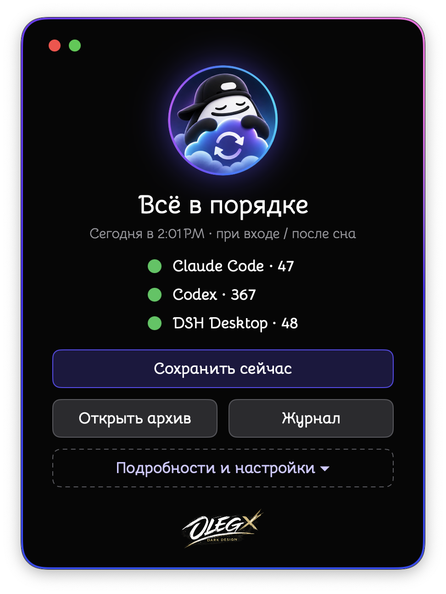
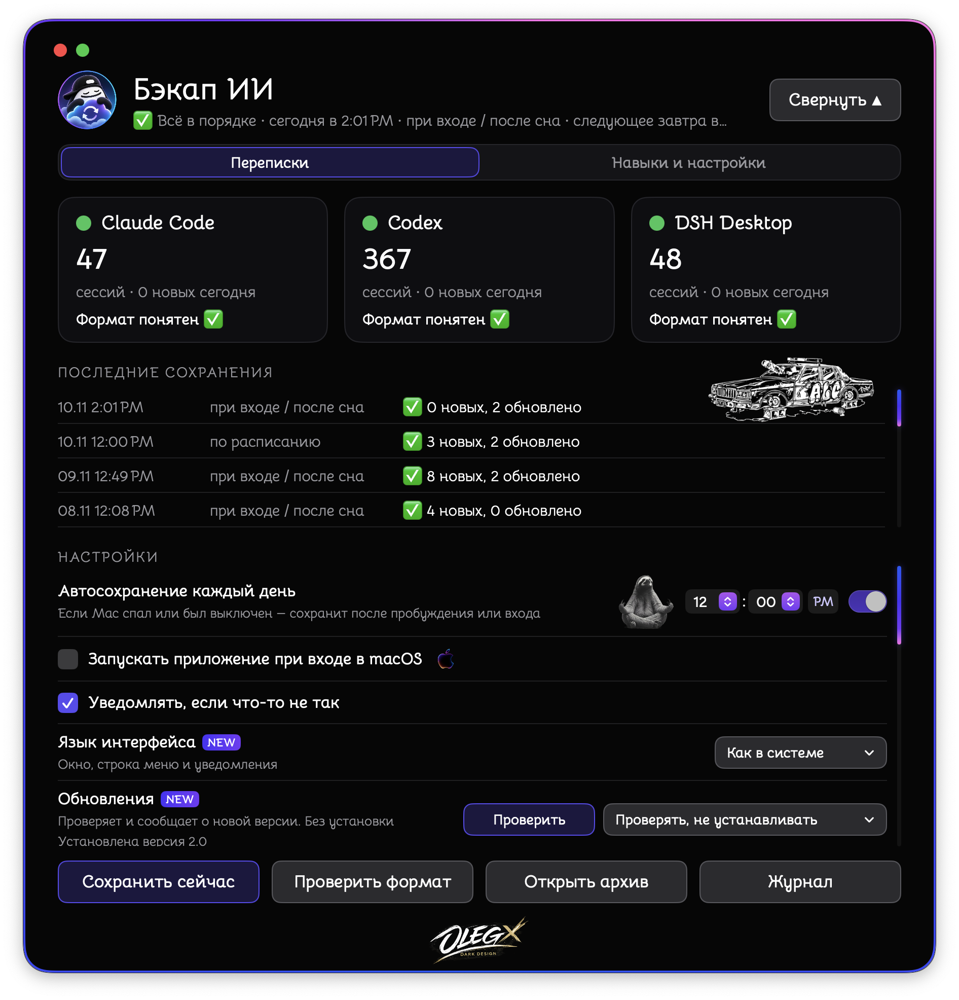
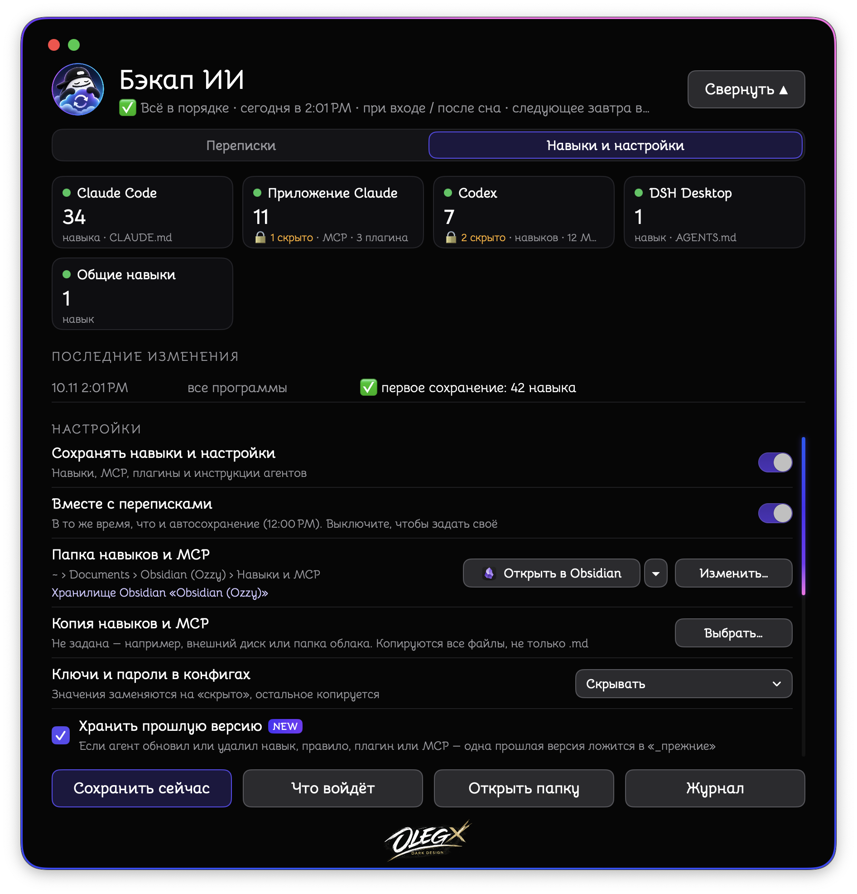

<p align="center">
  
  
  
</p>

# 💾 AI チャットバックアップ（AI Chat Backup）

[Русский](README.md) · [English](README.en.md) · [中文](README.zh.md) · 日本語 · [हिन्दी](README.hi.md)

> 🧠 AI との会話、エージェントのスキルと設定を、ふつうのファイルに。あなたの Mac に。インターネットなしで。

**⬇️ [Intel と Apple Silicon 用のアプリをダウンロード（DMG）](https://github.com/OzzyLabz/ozzy-ai-chat-backup/releases/latest/download/Ozzy-AI-Chat-Backup.dmg)**

> 🙏 この説明とアプリの日本語訳は作者によるもので、ネイティブスピーカーの確認を受けていません。誤りや不自然な表現に気づいたら、📧 [samo.zlo.spb@gmail.com](mailto:samo.zlo.spb@gmail.com) へメールするか、GitHub で issue を作成してください。修正します。

---

## ⚡ 概要

- 📝 Claude Code、Codex、DSH Desktop、Hermes、VS Code（Copilot Chat）、claude.ai、ChatGPT の会話を保存します。
- 🧰 AI エージェントのスキル、MCP サーバー、プラグイン、指示ファイルを保存します。GitHub に入手元がなくても、どのエージェントにも入れ直せます。
- 📂 すべてをフォルダに整理します。Obsidian、Markdown エディタ、Finder で読めます。
- ⏰ Mac がスリープしていても、1 日 1 回自動で保存します。
- 🌍 インターフェイスは 5 言語：Русский、English、中文、日本語、हिन्दी。
- 🔄 新しいバージョンを自分で見つけ、GitHub を開かずにアップデートできます。
- 🔒 どこにもデータを送りません。

会話はテキストだけを保存します。画像などの添付ファイルはコピーせず、その場所に `[画像]` のような印を残します。

---

## 🧩 機能

- ⏰ 選んだ時刻と macOS へのログイン時に毎日自動保存。Mac がスリープ中や電源オフだった場合は、復帰後に保存します。時刻の表示は macOS と同じ（12 時間制または 24 時間制）で、手入力もできます。
- ➕ 新しいメッセージは保存済みファイルの末尾に追記されます。書き込んだ内容は変わらず、AI アプリで削除した会話もアーカイブに残ります。
- 🧹 アプリの内部的な挿入（システムプロンプト、設定のスナップショット、コンテキスト圧縮時の要約）は保存しません。あなたのメッセージとモデルの返答だけです。
- 🛟 AI アプリがアップデートしてファイル形式が変わった場合も、予備の方法で会話を保存し、ウインドウとログで知らせます。履歴のエラーと警告には「何が起きたか / どうすればよいか」とボタンが表示されます。
- 💽 アーカイブを 2 つ目のフォルダ（外部ディスクなど）にコピーできます。
- 🚪 「…で開く」ボタン：選んだアプリでアーカイブを開きます。Finder、Obsidian（アーカイブが保管庫内にある場合）、VS Code、CotEditor、Nimble Commander、ターミナルなど。横にそのアプリのアイコンが表示されます。
- 🔔 claude.ai と ChatGPT のエクスポートをダウンロードするよう、月に 1 回お知らせします。

---

## 🧰 スキル、MCP、プラグイン

「スキルと設定」タブは、AI エージェントに入れたものを別の「スキルと MCP」フォルダに保存します（既定では Obsidian 保管庫の会話アーカイブの隣、Obsidian がなければ「書類」）。

| エージェント | 保存するもの | 状態 |
|---|---|---|
| Claude Code | スキル、`CLAUDE.md`、`settings.json`、MCP、プラグイン | ✅ 確認済み（プラグインはドキュメントに基づく） |
| Claude アプリ | MCP サーバー、プラグイン | ✅ 確認済み |
| Codex | スキル、`AGENTS.md`、ルール、`config.toml`、MCP、プラグインとマーケット | ✅ 確認済み |
| DSH Desktop | スキル、`AGENTS.md` | ✅ 確認済み |
| 共有スキル `~/.agents` | スキル | ✅ 確認済み |
| Hermes、Gemini CLI、Antigravity、Cursor、Windsurf、VS Code | スキル、指示、MCP、プラグインと拡張機能 | 🧪 公式ドキュメントに基づいて作成、実データでは未確認 |
| 自分のフォルダ（エージェントのメモリなど） | フォルダごと | ✅ |

```
スキルと MCP/
├── 概要.md                 ← 何があるか、バージョン、どのエージェントにあるか、入手元、戻し方
├── スキル/                 ← 各スキルを 1 回だけ、フォルダの正確なコピー
├── MCP.md                  ← 各サーバーを 1 回だけ、貼り付けられる設定ブロック付き
├── プラグイン.md           ← エージェントごと、入れ直すための入手元付き
├── エージェントの指示/     ← CLAUDE.md、AGENTS.md、設定 — エージェントごと
├── マイフォルダ/
├── _以前のバージョン/      ← エージェントが更新・削除したものの 1 つ前のバージョン
└── 変更ログ.md
```

- 🔑 **設定ファイル内のキーとパスワード** — 選べます：隠す（`‹非表示›` に置き換え）、そのまま保存、そのようなファイルを保存しない。
- ⛔ **決してコピーしないもの：** サインインのファイル（`auth.json`、`.credentials…`、`.env`）、プラグインのキャッシュ、`node_modules`、`.git`。
- 🎯 **基準はエージェントに入っている内容です。** コピーは正確で、コピーを編集しても次回の保存で正確なコピーに戻ります。
- ⏱️ 会話と一緒に、または別の時刻に保存します。「プレビュー」で、何も書き込まずにコピー内容を確認できます。
- ウインドウには Mac で見つかったエージェントだけが表示されます。通常と違う場所にある場合は「アプリを追加…」を使います。

フォルダとファイルの名前はアプリの言語に従います。日本語では上のとおりです。

---

## 🤖 会話の保存に対応するアプリ

| アプリ | 会話の取得元 | 状態 |
|---|---|---|
| Claude Code | `~/.claude/projects` のファイル | ✅ 確認済み |
| Codex | `~/.codex/sessions`、`~/.codex/archived_sessions` のファイルと履歴データベース | ✅ 確認済み |
| DSH Desktop | `~/.dsh/sessions` の圧縮ファイル | ✅ 確認済み |
| Hermes | データベース `~/.hermes/state.db` | 🧪 公式ドキュメントに基づいて作成、実データでは未確認 |
| VS Code（Copilot Chat） | VS Code 設定内の `chatSessions` フォルダ | 🧪 実験的：形式は公式に説明されていません |
| claude.ai、ChatGPT | サイトからダウンロードしたエクスポート（ZIP、フォルダ、JSON） | 🧪 エクスポート形式に基づいて作成、実際のエクスポートでは未確認。会話のすべての分岐を保存します |
| Cursor、Windsurf など | `.md` または `.txt` のエクスポートを置いたフォルダ | 📄 ファイルをそのままコピー |

どのアプリもウインドウでデータのパスを変更（「ソース → パスを変更…」）したり、オフにしたりできます。一覧には見つかったアプリだけが表示され、通常と違う場所にあるものは「アプリを追加…」で追加できます。

⏳ Claude Code は既定で 30 日より前の会話を削除します。アプリで 30 日、1 年、10 年から選べます。変更されるのは `~/.claude/settings.json` の `cleanupPeriodDays` という設定 1 つだけで、変更前にファイルのコピーを隣に保存します。

---

## 🗃️ アーカイブの構成

```
AI チャット履歴/
├── Claude Code/
│   └── 2026-11-03/
│       └── 会話のタイトル.md
├── Codex/
├── claude.ai/
└── 保存ログ.md
```

各ファイルの先頭には、Obsidian が読めるプロパティとして日付、時刻、プロジェクト、セッション番号があり、その下に会話が続きます。「保存ログ」には、いつどれだけ保存したかが記録されます。

🌍 ファイル内の決まった言葉（プロパティ名、印、ログ、「スキルと MCP」のフォルダ）はアプリの言語で書かれます。言語を変えると、アプリは自分のファイルの名前を変え、保存済みの内容の決まった言葉を書き換え、Obsidian 保管庫内のリンクも直します。あなたが選んだり名前を付けたりしたフォルダには触れません。

🪨 **Obsidian。** アプリに Obsidian は必要ありません。Obsidian がインストールされていれば、アーカイブは既定で最後に開いた保管庫の「AI チャット履歴」フォルダに置かれます。設定の「アーカイブのフォルダ」の行で、どの保管庫にあるかがわかります。Obsidian がない場合は、同じ行に公式ダウンロードページへのリンクがあります。Obsidian は無料で、このアプリは Obsidian を含まず、配布もしません。

---

## 🌍 言語

インターフェイス、メッセージ、通知、メニューはロシア語、英語、中国語、日本語、ヒンディー語に対応しています。言語は設定（「表示言語」）で選ぶか、システムに合わせます。言語を変えるとアプリは同じ場所で再起動し、macOS のメニュー項目も切り替わります。

---

## 🔄 アップデート

「会話」の設定の「アップデート」の行：

- **自動でアップデート** — アップデートを自動で確認・ダウンロード・インストールします。
- **確認のみ（インストールしない）**（既定）— 新しいバージョンを知らせて「新機能」を表示します。インストールはお好きなときに。
- **アップデートをオフにする** — アップデートを確認しません。

アップデートは作者の鍵で署名されており、本物のリリースだけがインストールされます。[Sparkle](https://sparkle-project.org) を使っています。バージョン 1.0 はアップデートを確認しないため、2.0 は一度だけ手動でダウンロードしてください。その後のアップデートは自動で届きます。

---

## 🖥️ システム要件と確認状況

- 💻 1 つの `.app` に Intel（`x86_64`）と Apple Silicon（`arm64`）のコードが入っています。
- 🍏 最低バージョン：**macOS 13.0**。
- ✅ Intel と macOS 15 で確認済み：ビルド、起動、会話とスキルの保存、5 言語、ローカルフィードからのアップデート。
- 🧪 Apple Silicon と古いバージョンの macOS ではまだ確認していません。

---

## 📦 インストールと初回起動

1. DMG をダウンロードして開き、アプリを「アプリケーション」へドラッグします。Finder での名前はシステムの言語に従います（「AI チャットバックアップ」「AI Chat Backup」など）。
2. ⚠️ アプリは ad hoc 署名のみで、Apple の公証を受けていません。初回起動時に「開発元が未確認」と表示された場合は、**システム設定 → プライバシーとセキュリティ** から開いてください。詳しくは [Apple のガイド](https://support.apple.com/ja-jp/guide/mac-help/mh40616/mac) を参照してください。
3. 初回起動時にアーカイブのフォルダを選び、「開始」をクリックします。🎉

1.0 からのアップデートですか？ 2.0 を入れて起動するだけです。設定、アーカイブ、スケジュールはそのまま残ります。古い「Бэкап ИИ.app」は削除してかまいません。

---

## 🚀 使い方

- 💾 **「今すぐ保存」** — スケジュールを待たずに手動で保存。
- 📂 **「アーカイブを開く」** — 選んだアプリでアーカイブを開く。
- 📜 **「ログ」** — いつ何を保存したかを見る。
- ⚙️ **「詳細と設定」** — 2 つのタブ：「会話」（自動保存の時刻、ログイン時の起動、通知、言語、アップデート、アーカイブとコピーのフォルダ、ソース、サイトのエクスポートの読み込み）と「スキルと設定」。

🌐 **claude.ai と ChatGPT の会話。** サイトでデータのエクスポートを依頼します：

- claude.ai（サイトまたは Claude Desktop）：設定 → プライバシー → Export data。リンクはメールで届き、24 時間有効です。
- ChatGPT：Settings → Data controls → Export data。メールは遅れて届くことがあり（最大 7 日）、リンクは 24 時間有効です。

ダウンロードした ZIP をアプリのウインドウにドラッグするか、「エクスポートを読み込む…」をクリックします。再度読み込むと新しい分が追加され、古い分は失われません。同じ説明はアプリの「入手方法」ボタンにもあります。

---

## 🔒 プライバシー

- 🏠 すべてはあなたの Mac 上で行われます。アプリに解析機能はなく、あなたのデータをインターネットに送りません。インターネットに接続するのはアップデートの確認（GitHub 上のバージョン一覧ファイル）のときだけで、オフにできます。「Obsidian をダウンロード」のリンクはブラウザでページを開くだけです。
- 👀 アプリは AI アプリのファイルとデータベースを読むだけで、変更しません。唯一の例外は Claude Code の保存期間の設定で、それもあなたが選んだときだけです。
- 🔑 設定ファイル内のキーは既定で隠されます。サインインのファイルは決してコピーしません。
- ☁️ アーカイブや「スキルと MCP」が同期の有効な Obsidian 保管庫（Obsidian Sync、iCloud など）にある場合や、コピーがクラウドのフォルダにある場合、データはそのクラウドに入ります。これはアプリではなく、あなたの設定によります。

---

## 🧰 アプリのデータの保存場所と停止方法

- 設定と状態：`~/Library/Application Support/Бэкап ИИ/`。
- スケジュール：`~/Library/LaunchAgents/com.ozzy.backup-ai.plist`。スキルを別の時刻に保存する場合は `com.ozzy.backup-ai.kit.plist` も。

完全に停止するには：アプリで「毎日自動保存」と「スキルと設定をバックアップ」をオフにし、「macOS ログイン時に起動」のチェックを外してから、アプリを終了します。アーカイブと「スキルと MCP」は残ります。

---

## 🚧 制限事項

- claude.ai と ChatGPT の会話は、サイトのエクスポートでのみ取得できます。
- Cursor と Windsurf は履歴を内部形式で保存するため、`.md` のエクスポートだけを読み込みます。
- 保存できるのはディスクに残っているものだけです。AI アプリがすでに古い会話を削除していれば、復元できません。
- 進行中の会話の最後のメッセージは、次回の保存で保存されます。
- スキルと MCP の復元は、`概要.md` の説明に従って手動で行います。アプリはエージェントのフォルダに書き込みません。

---

## 🛠️ ソースとビルド

ソースは `Sources/`、リソースは `Resources/`（翻訳は `Resources/Lang/`）、アップデートのライブラリは `Vendor/Sparkle` にあります。ビルド：`RELEASE=1 ./build.sh` → `dist/AI Chat Backup.app`（Swift。`swiftc` で 2 つのアーキテクチャ向けにビルドし `lipo` でまとめます。Xcode プロジェクトは不要）。Xcode をインストールした環境で確認済み。DMG：`./make-dmg.sh`。アップデート一覧 `appcast.xml` は Sparkle のツールで署名します（[Sparkle 2.10.1 リリース](https://github.com/sparkle-project/Sparkle/releases/tag/2.10.1)）。

同梱の `zstd` 展開ツールは公式の [facebook/zstd](https://github.com/facebook/zstd) 1.5.7 のソースからビルドしています。サードパーティのコンポーネントとライセンス：[THIRD_PARTY_NOTICES.md](THIRD_PARTY_NOTICES.md)。

---

## ⚖️ ライセンス

Copyright (c) 2026 OzzyLabz。アプリのオリジナルのコードとドキュメントは独自の[非商用利用ライセンス 1.0](LICENSE) で配布されます。使用、変更、配布は非商用目的に限り許可されます。アプリの販売や、対象となる資料を収入や商業的利益のために使用するには、別途書面による許可が必要です。サードパーティのコンポーネントはそれぞれのライセンスに従います：[THIRD_PARTY_NOTICES.md](THIRD_PARTY_NOTICES.md)。

---

## ✍️ 作者

アイデア、デザイン、アプリ：**Ozzy** 🥷🏾

---

## 📬 うまく動かないときは 🤝

バグを見つけた、アイデアがある、お礼を伝えたい — メールをください：
📧 [**samo.zlo.spb@gmail.com**](mailto:samo.zlo.spb@gmail.com)

同じアドレスは作者のウインドウ（アプリのウインドウ下部のロゴ）にもあり、エラーが起きるとアプリに「作者にメール」ボタンが表示されます。

問題をすばやく見つけて直すために、メールに次のことを書いてください：

- 🪜 何をして、何がうまくいかなかったか — 手順ごとに簡潔に；
- 📸 エラーのスクリーンショット；
- 🍏 macOS のバージョン（アップルメニュー →「この Mac について」）；
- 💻 Mac の機種とチップ：Intel か Apple Silicon（M1、M2 など）；
- 🏷️ アプリのバージョン（設定の「アップデート」の行）；
- 🤖 関係する AI アプリ（Claude Code、Codex など）、エラーがそれに関係する場合。
