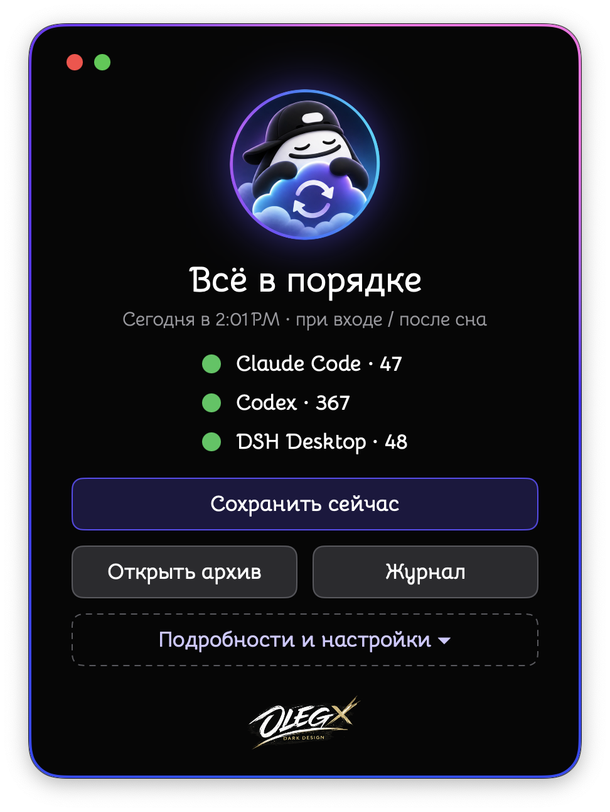
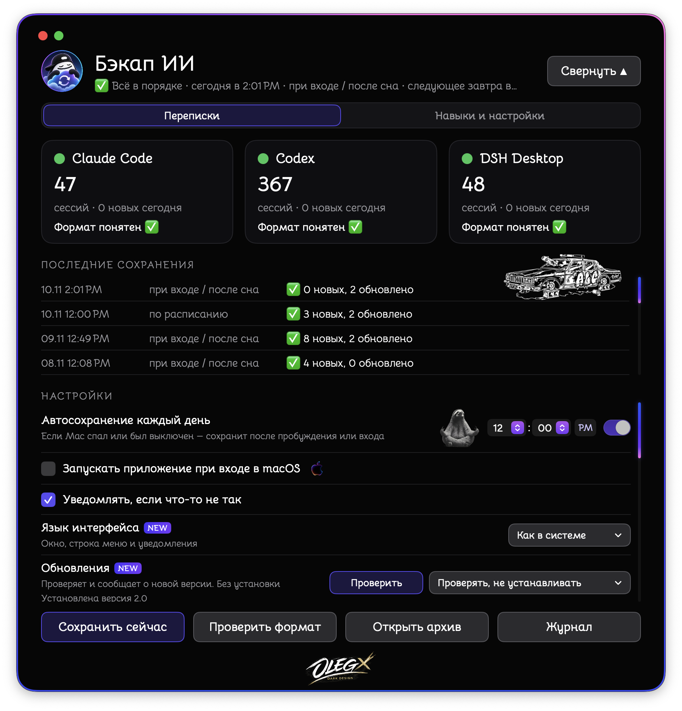
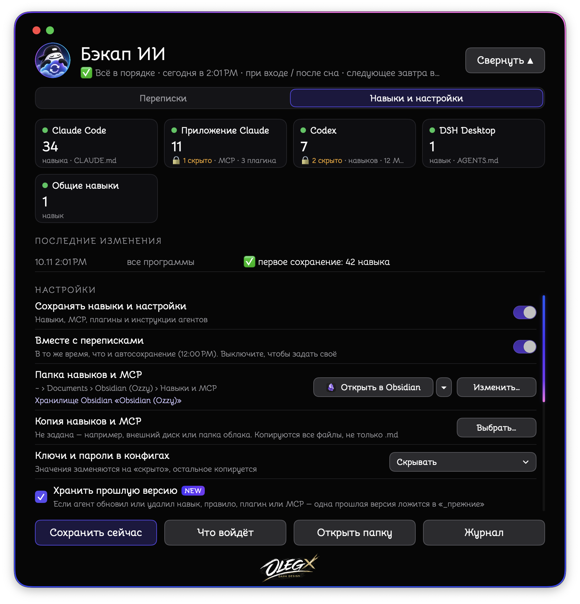

<p align="center">
  
  
  
</p>

# 💾 Бэкап ИИ (AI Chat Backup)

Русский · [English](README.en.md) · [中文](README.zh.md) · [日本語](README.ja.md) · [हिन्दी](README.hi.md)

> 🧠 Твои переписки с ИИ, навыки и настройки агентов — в обычных файлах. На твоём Mac. Без интернета.

**⬇️ [Скачать приложение для Intel и Apple Silicon (DMG)](https://github.com/OzzyLabz/ozzy-ai-chat-backup/releases/latest/download/Ozzy-AI-Chat-Backup.dmg)**

---

## ⚡ Коротко

- 📝 Сохраняет чаты Claude Code, Codex, DSH Desktop, Hermes, VS Code (Copilot Chat), claude.ai и ChatGPT.
- 🧰 Сохраняет навыки, MCP-серверы, плагины и инструкции ИИ-агентов — чтобы поставить их заново на любой агент, даже если у них нет источника на GitHub.
- 📂 Раскладывает всё по папкам — читай в Obsidian, любом редакторе Markdown или прямо в Finder.
- ⏰ Сам сохраняет раз в день, даже если Mac спал.
- 🌍 Интерфейс на 5 языках: русский, English, 中文, 日本語, हिन्दी.
- 🔄 Сам находит новые версии и может обновиться без захода на GitHub.
- 🔒 Ничего никуда не отправляет.

Из переписок сохраняется только текст. Картинки и другие вложения не копируются: на их месте в файле стоит пометка, например `[изображение]`.

---

## 🧩 Возможности

- ⏰ Автосохранение раз в день в выбранное время и при входе в macOS. Если Mac спал или был выключен, сохранение выполнится после пробуждения. Время — как в macOS (12 или 24 часа), его можно вписать руками.
- ➕ Новые сообщения дописываются в конец уже сохранённого файла. Записанное раньше не меняется, а удалённое в самой программе ИИ в архиве остаётся.
- 🧹 Служебные вставки программ (системные подсказки, снимки настроек, пересказы при сжатии контекста) в архив не попадают — только твои сообщения и ответы модели.
- 🛟 Если программа ИИ обновилась и формат её файлов изменился, «Бэкап ИИ» сохраняет переписку запасным способом и предупреждает об этом в окне и в журнале. В истории у ошибок и предупреждений есть «Что случилось / Что делать» и кнопки.
- 💽 Копия архива во вторую папку, например на внешний диск.
- 🚪 Кнопка «Открыть в …»: архив открывается в выбранной программе — Finder, Obsidian (если архив лежит в его хранилище), VS Code, CotEditor, Nimble Commander, Терминал или любая другая. Рядом — значок этой программы, такой же, как у тебя в системе.
- 🔔 Напоминание раз в месяц скачать экспорт переписок с сайтов claude.ai и ChatGPT.

---

## 🧰 Навыки, MCP и плагины

Вкладка «Навыки и настройки» сохраняет то, чем ты оснастил ИИ-агентов, в отдельную папку «Навыки и MCP» (по умолчанию — рядом с «Историей ИИ» в хранилище Obsidian, без Obsidian — в «Документах»).

| Агент | Что сохраняется | Состояние |
|---|---|---|
| Claude Code | навыки, `CLAUDE.md`, `settings.json`, MCP, плагины | ✅ проверено (плагины — по документации) |
| Приложение Claude | MCP-серверы, плагины | ✅ проверено |
| Codex | навыки, `AGENTS.md`, правила, `config.toml`, MCP, плагины и маркеты | ✅ проверено |
| DSH Desktop | навыки, `AGENTS.md` | ✅ проверено |
| Общие навыки `~/.agents` | навыки | ✅ проверено |
| Hermes, Gemini CLI, Antigravity, Cursor, Windsurf, VS Code | навыки, инструкции, MCP, плагины и расширения | 🧪 сделано по официальной документации, на настоящих данных не проверено |
| Свои папки (например, память агентов) | папка целиком | ✅ |

```
Навыки и MCP/
├── Обзор.md              ← что есть, версия, в каких агентах стоит, откуда взято, как вернуть
├── Навыки/               ← каждый навык один раз, точная копия папки
├── MCP.md                ← каждый сервер один раз, с готовым блоком настроек для вставки
├── Плагины.md            ← по агентам, с источником, откуда ставить заново
├── Инструкции агентов/   ← CLAUDE.md, AGENTS.md, настройки — по агентам
├── Свои папки/
├── _прежние/             ← одна прошлая версия того, что агент обновил или удалил
└── Журнал изменений.md
```

- 🔑 **Ключи и пароли в конфигах** — на выбор: скрывать (заменяются на `‹скрыто›`), сохранять как есть или не сохранять такие файлы.
- ⛔ **Никогда не копируются:** файлы входа (`auth.json`, `.credentials…`, `.env`), кэши плагинов, `node_modules`, `.git`.
- 🎯 **Главное — то, что стоит у агента.** Копии точные; если поправить копию, при следующем сохранении она снова станет точной.
- ⏱️ Сохраняется вместе с переписками или в своё время. «Что войдёт» показывает, что будет скопировано, ничего не записывая.
- В окне видны только найденные агенты; если агент стоит в необычном месте — «Добавить программу…».

---

## 🤖 Какие программы поддерживаются для переписок

| Программа | Откуда берётся переписка | Состояние |
|---|---|---|
| Claude Code | файлы `~/.claude/projects` | ✅ проверено |
| Codex | файлы `~/.codex/sessions`, `~/.codex/archived_sessions` и база истории | ✅ проверено |
| DSH Desktop | сжатые файлы `~/.dsh/sessions` | ✅ проверено |
| Hermes | база `~/.hermes/state.db` | 🧪 сделано по официальной документации, на настоящих данных не проверено |
| VS Code (Copilot Chat) | папки `chatSessions` в настройках VS Code | 🧪 экспериментально: формат официально не описан |
| claude.ai, ChatGPT | экспорт, скачанный с сайта (ZIP, папка или JSON) | 🧪 сделано по формату экспорта, на настоящих экспортах пока не проверено; сохраняются все ветки разговора |
| Cursor, Windsurf и другие | твои папки с экспортом в `.md` или `.txt` | 📄 файлы копируются как есть |

Путь к данным любой программы можно изменить в окне («Источники → Изменить путь…»), ненужную — выключить. В списке видны только найденные программы; стоящую в необычном месте можно добавить кнопкой «Добавить программу…».

⏳ Claude Code по умолчанию удаляет переписки старше 30 дней. В программе можно выбрать срок: 30 дней, 1 год или 10 лет. Меняется одна настройка `cleanupPeriodDays` в `~/.claude/settings.json`; перед правкой рядом сохраняется копия файла.

---

## 🗃️ Как устроен архив

```
История ИИ/
├── Claude Code/
│   └── 2026-11-03/
│       └── Название разговора.md
├── Codex/
├── claude.ai/
└── Журнал сохранений.md
```

Вверху каждого файла — дата, время, проект и номер сессии в виде свойств, которые понимает Obsidian. Ниже — сам разговор. В «Журнале сохранений» записано, когда и сколько сохранено.

🌍 Служебные слова в файлах (названия полей, пометки, журнал, папки «Навыков и MCP») пишутся на языке программы. Если сменить язык, программа сама переименует свои файлы, перепишет служебные строки в уже сохранённом и поправит ссылки на них в хранилище Obsidian. Папки, которые ты выбрал или назвал сам, она не трогает.

🪨 **Obsidian.** Программе Obsidian не нужен. Если Obsidian установлен, при первом запуске архив по умолчанию кладётся в твоё последнее открытое хранилище, в папку «История ИИ». В настройках, в строке «Папка архива», видно, в каком хранилище лежит архив. Если Obsidian не установлен, там же есть ссылка на официальную страницу загрузки. Obsidian бесплатен; программа его не содержит и не распространяет.

---

## 🌍 Языки

Интерфейс, сообщения, уведомления и меню — на русском, английском, китайском, японском и хинди. Язык выбирается в настройках («Язык интерфейса») или берётся как в системе. После смены языка программа перезапускается на том же месте, чтобы и системные пункты меню macOS сменили язык.

🙏 Переводы на китайский, японский и хинди сделаны без носителей языка. Если видишь ошибку или неуклюжую фразу — напиши на 📧 [samo.zlo.spb@gmail.com](mailto:samo.zlo.spb@gmail.com) или открой issue на GitHub: исправлю.

---

## 🔄 Обновления

В настройках «Переписок», строка «Обновления»:

- **Обновлять автоматически** — проверяет, скачивает и устанавливает обновления сама;
- **Проверять, не устанавливать** (по умолчанию) — сообщает о новой версии, показывает «Что нового», устанавливаешь когда захочешь;
- **Отключить обновления** — программа не проверяет обновления.

Обновления подписаны ключом автора: программа ставит только подлинные выпуски. Работает на [Sparkle](https://sparkle-project.org). Версия 1.0 обновления не проверяет — 2.0 нужно один раз скачать вручную, дальше обновления придут сами.

---

## 🖥️ Системные требования и состояние проверки

- 💻 Одна `.app` содержит код для Intel (`x86_64`) и Apple Silicon (`arm64`).
- 🍏 Минимальная версия — **macOS 13.0**.
- ✅ Проверено на Intel с macOS 15: сборка, запуск, сохранение переписок и навыков, 5 языков, обновление со своей ленты.
- 🧪 На Apple Silicon и на более старых версиях macOS программа пока не проверялась.

---

## 📦 Установка и первый запуск

1. Скачай DMG, открой его и перетащи программу в «Программы». В Finder она называется на языке системы: «Бэкап ИИ», «AI Chat Backup» и т. д.
2. ⚠️ Приложение подписано только ad hoc и не нотариализовано Apple. При первом запуске macOS может предупредить о неизвестном разработчике — тогда открой его через **Системные настройки → Конфиденциальность и безопасность**. Подробности: [инструкция Apple](https://support.apple.com/guide/mac-help/open-a-mac-app-from-an-unknown-developer-mh40616/mac).
3. При первом запуске выбери папку для архива и нажми «Начать». 🎉

Обновляешься с 1.0? Просто поставь 2.0 и запусти: настройки, архив и расписание сохранятся. Старую «Бэкап ИИ.app» можно удалить.

---

## 🚀 Использование

- 💾 **«Сохранить сейчас»** — сохранить вручную, не дожидаясь расписания.
- 📂 **«Открыть архив»** — открыть архив в выбранной программе.
- 📜 **«Журнал»** — посмотреть, когда и что сохранялось.
- ⚙️ **«Подробности и настройки»** — две вкладки: «Переписки» (время автосохранения, автозапуск, уведомления, язык, обновления, папка архива и копии, источники, импорт экспорта с сайтов) и «Навыки и настройки».

🌐 **Переписки с claude.ai и ChatGPT.** Запроси экспорт данных на сайте:

- claude.ai (сайт или Claude Desktop): Настройки → Конфиденциальность → Export data. Ссылка придёт на почту и действует 24 часа.
- ChatGPT: Settings → Data controls → Export data. Письмо может прийти не сразу (до 7 дней), ссылка действует 24 часа.

Скачанный ZIP перетащи в окно программы или нажми «Импортировать экспорт…». Повторный импорт добавляет новое, старое не теряется. Эта же подсказка есть в программе — кнопка «Как скачать?».

---

## 🔒 Конфиденциальность

- 🏠 Всё происходит на твоём Mac. Программа не содержит аналитики и не отправляет твои данные в интернет. В интернет она обращается только за проверкой обновлений (файл со списком версий на GitHub) — это можно выключить. Ссылка «Скачать Obsidian» просто открывает страницу в браузере.
- 👀 Файлы и базы программ ИИ программа только читает и ничего в них не меняет. Исключение — настройка срока хранения Claude Code, и только по твоему выбору.
- 🔑 Ключи в конфигах по умолчанию скрываются; файлы входа не копируются никогда.
- ☁️ Если архив или «Навыки и MCP» лежат в хранилище Obsidian с включённой синхронизацией (Obsidian Sync, iCloud и т. п.) или копия — в облачной папке, данные попадут в это облако. Это зависит от твоих настроек, а не от программы.

---

## 🧰 Где программа хранит свои данные и как её отключить

- Настройки и состояние: `~/Library/Application Support/Бэкап ИИ/`.
- Расписание: `~/Library/LaunchAgents/com.ozzy.backup-ai.plist`; если навыки сохраняются в своё время — ещё `com.ozzy.backup-ai.kit.plist`.

Чтобы отключить полностью: в программе выключи «Автосохранение каждый день», «Сохранять навыки и настройки» и сними «Запускать приложение при входе в macOS», затем выйди из программы. Архив и «Навыки и MCP» остаются на месте.

---

## 🚧 Ограничения

- Переписки claude.ai и ChatGPT доступны только через экспорт с сайта.
- Cursor и Windsurf хранят историю во внутренних форматах — программа берёт только их экспорт в `.md`.
- Сохраняется то, что ещё лежит на диске: если программа ИИ уже удалила старые переписки, восстановить их нельзя.
- Последняя реплика разговора, который идёт прямо сейчас, сохраняется при следующем сохранении.
- Восстановление навыков и MCP — вручную, по подсказке в `Обзор.md`: программа в папки агентов не пишет.

---

## 🛠️ Исходники и сборка

Исходники — в `Sources/`, ресурсы — в `Resources/` (переводы — `Resources/Lang/`), библиотека обновлений — `Vendor/Sparkle`. Сборка: `RELEASE=1 ./build.sh` → `dist/AI Chat Backup.app` (Swift, `swiftc` под две архитектуры и `lipo`, без проекта Xcode). Проверено с установленным Xcode. DMG: `./make-dmg.sh`. Список обновлений `appcast.xml` подписывается утилитами Sparkle ([выпуск Sparkle 2.10.1](https://github.com/sparkle-project/Sparkle/releases/tag/2.10.1)).

Встроенный распаковщик `zstd` собран из официальных исходников [facebook/zstd](https://github.com/facebook/zstd) 1.5.7. Сторонние компоненты и их лицензии: [THIRD_PARTY_NOTICES.md](THIRD_PARTY_NOTICES.md).

---

## ⚖️ Лицензия

Copyright (c) 2026 OzzyLabz. Оригинальный код приложения и документация распространяются по собственной [Лицензии некоммерческого использования 1.0](LICENSE). Использование, изменение и распространение разрешены исключительно для некоммерческих целей. Продажа программы или использование охватываемых материалов для получения дохода либо коммерческой выгоды требует отдельного письменного разрешения. Сторонние компоненты сохраняют собственные лицензии: [THIRD_PARTY_NOTICES.md](THIRD_PARTY_NOTICES.md).

---

## ✍️ Автор

Идея, дизайн и программа: **Ozzy** 🥷🏾

---

## 📬 Если что-то не работает 🤝

Нашёл баг, есть идея или хочешь сказать спасибо — пиши:
📧 [**samo.zlo.spb@gmail.com**](mailto:samo.zlo.spb@gmail.com)

Тот же адрес есть в окне об авторе (логотип внизу окна программы), а при ошибке в программе появляется кнопка «Написать автору».

Чтобы ошибку можно было быстро найти и исправить, укажи в письме:

- 🪜 что делал и что пошло не так — кратко, по шагам;
- 📸 снимок экрана с ошибкой;
- 🍏 версию macOS (меню Apple → «Об этом Mac»);
- 💻 модель Mac и процессор: Intel или Apple Silicon (M1, M2 и т. д.);
- 🏷️ версию программы (в настройках, строка «Обновления»);
- 🤖 о какой программе ИИ речь (Claude Code, Codex и т. д.), если ошибка связана с ней.
