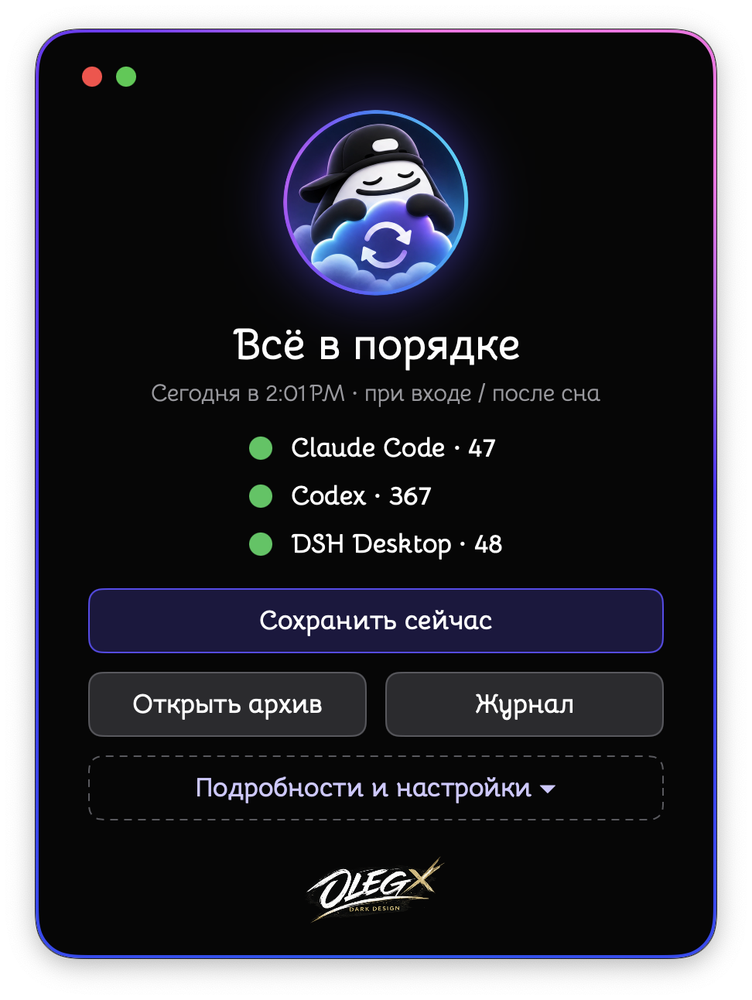
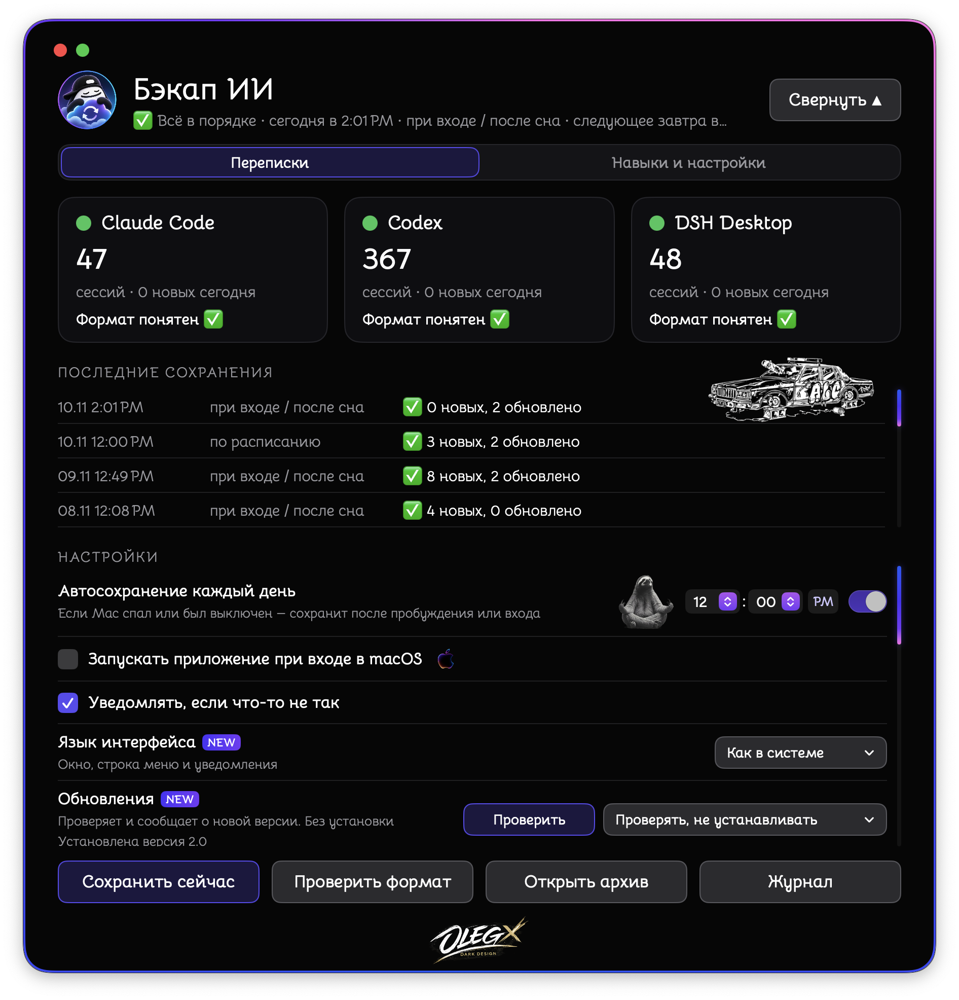
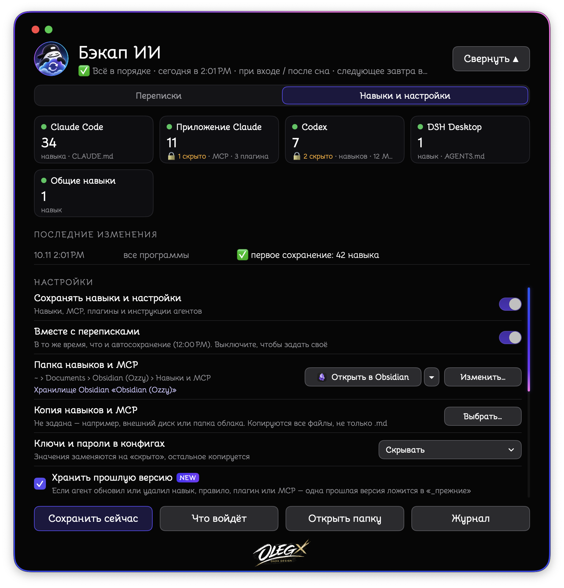

<p align="center">
  
  
  
</p>

# 💾 AI 聊天备份（AI Chat Backup）

[Русский](README.md) · [English](README.en.md) · 中文 · [日本語](README.ja.md) · [हिन्दी](README.hi.md)

> 🧠 你与 AI 的对话、代理的技能和设置——保存为普通文件。就在你的 Mac 上。无需联网。

**⬇️ [下载适用于 Intel 和 Apple Silicon 的应用（DMG）](https://github.com/OzzyLabz/ozzy-ai-chat-backup/releases/latest/download/Ozzy-AI-Chat-Backup.dmg)**

> 🙏 本说明和程序的中文翻译由作者完成，没有母语者校对。如发现错误或不自然的表达，请写信至 📧 [samo.zlo.spb@gmail.com](mailto:samo.zlo.spb@gmail.com) 或在 GitHub 上提交 issue，我会修正。

---

## ⚡ 简介

- 📝 保存 Claude Code、Codex、DSH Desktop、Hermes、VS Code（Copilot Chat）、claude.ai 和 ChatGPT 的对话。
- 🧰 保存 AI 代理的技能、MCP 服务器、插件和说明文件——即使它们在 GitHub 上没有来源，也能在任何代理上重新安装。
- 📂 一切按文件夹整理——可在 Obsidian、任意 Markdown 编辑器或 Finder 中阅读。
- ⏰ 每天自动保存一次，即使 Mac 处于睡眠状态。
- 🌍 界面支持 5 种语言：Русский、English、中文、日本語、हिन्दी。
- 🔄 自动发现新版本，无需访问 GitHub 即可更新。
- 🔒 不向任何地方发送数据。

对话只保存文本。图片和其他附件不会复制：文件中会在相应位置留下标记，例如 `[图片]`。

---

## 🧩 功能

- ⏰ 每天在你选择的时间以及登录 macOS 时自动保存。如果 Mac 曾睡眠或关机，会在唤醒后保存。时间格式与 macOS 一致（12 或 24 小时制），也可以手动输入。
- ➕ 新消息追加到已保存文件的末尾。已写入的内容不会改变；在 AI 应用中删除的对话仍保留在存档中。
- 🧹 程序的系统插入内容（系统提示、设置快照、压缩上下文时的摘要）不会进入存档——只保存你的消息和模型的回复。
- 🛟 如果 AI 应用更新后文件格式变化，AI 聊天备份会用备用方式保存对话，并在窗口和日志中提示。历史记录中的错误和警告会显示“发生了什么 / 该怎么做”以及相应按钮。
- 💽 可将存档复制到第二个文件夹，例如外置磁盘。
- 🚪 “在…中打开”按钮：用你选择的应用打开存档——Finder、Obsidian（如果存档在其库中）、VS Code、CotEditor、Nimble Commander、终端或其他应用，并显示该应用的图标。
- 🔔 每月提醒一次从 claude.ai 和 ChatGPT 网站下载对话导出。

---

## 🧰 技能、MCP 和插件

“技能与设置”标签页会把你为 AI 代理配备的内容保存到单独的“技能和 MCP”文件夹中（默认放在 Obsidian 库中对话存档的旁边；没有 Obsidian 时放在“文稿”中）。

| 代理 | 保存的内容 | 状态 |
|---|---|---|
| Claude Code | 技能、`CLAUDE.md`、`settings.json`、MCP、插件 | ✅ 已测试（插件按文档实现） |
| Claude 应用 | MCP 服务器、插件 | ✅ 已测试 |
| Codex | 技能、`AGENTS.md`、规则、`config.toml`、MCP、插件和市场 | ✅ 已测试 |
| DSH Desktop | 技能、`AGENTS.md` | ✅ 已测试 |
| 共享技能 `~/.agents` | 技能 | ✅ 已测试 |
| Hermes、Gemini CLI、Antigravity、Cursor、Windsurf、VS Code | 技能、说明、MCP、插件和扩展 | 🧪 按官方文档实现，未在真实数据上测试 |
| 你自己的文件夹（例如代理的记忆） | 整个文件夹 | ✅ |

```
技能和 MCP/
├── 概览.md        ← 有什么、版本、安装在哪些代理中、来源、如何恢复
├── 技能/          ← 每个技能只保存一次，文件夹的准确副本
├── MCP.md         ← 每个服务器只列一次，附可直接粘贴的配置块
├── 插件.md        ← 按代理列出，附重新安装的来源
├── 代理说明/      ← CLAUDE.md、AGENTS.md、设置——按代理分类
├── 我的文件夹/
├── _旧版本/       ← 代理更新或删除的内容保留一个旧版本
└── 变更日志.md
```

- 🔑 **配置中的密钥和密码**——可选：隐藏（替换为 `‹已隐藏›`）、原样保存，或不保存这类文件。
- ⛔ **从不复制：** 登录文件（`auth.json`、`.credentials…`、`.env`）、插件缓存、`node_modules`、`.git`。
- 🎯 **以代理中安装的内容为准。** 副本是准确的；如果修改了副本，下次保存时会恢复为准确副本。
- ⏱️ 与对话一起保存，或在单独的时间保存。“预览”会显示要复制的内容，而不写入任何文件。
- 窗口中只显示在 Mac 上找到的代理；如果代理安装在不常见的位置，可使用“添加应用…”。

文件夹和文件的名称跟随程序语言——中文界面下如上所示。

---

## 🤖 支持的对话来源

| 应用 | 对话来源 | 状态 |
|---|---|---|
| Claude Code | `~/.claude/projects` 中的文件 | ✅ 已测试 |
| Codex | `~/.codex/sessions`、`~/.codex/archived_sessions` 中的文件和历史数据库 | ✅ 已测试 |
| DSH Desktop | `~/.dsh/sessions` 中的压缩文件 | ✅ 已测试 |
| Hermes | 数据库 `~/.hermes/state.db` | 🧪 按官方文档实现，未在真实数据上测试 |
| VS Code（Copilot Chat） | VS Code 设置中的 `chatSessions` 文件夹 | 🧪 实验性：格式没有官方说明 |
| claude.ai、ChatGPT | 从网站下载的导出（ZIP、文件夹或 JSON） | 🧪 按导出格式实现，尚未在真实导出上测试；会保存对话的所有分支 |
| Cursor、Windsurf 等 | 你保存 `.md` 或 `.txt` 导出的文件夹 | 📄 文件原样复制 |

可以在窗口中更改任何应用的数据路径（“来源 → 更改路径…”），或关闭不需要的应用。列表中只显示找到的应用；安装在不常见位置的应用可通过“添加应用…”添加。

⏳ Claude Code 默认会删除 30 天前的对话。在程序中可以选择 30 天、1 年或 10 年。这只会修改 `~/.claude/settings.json` 中的一项设置 `cleanupPeriodDays`；修改前会在旁边保存文件副本。

---

## 🗃️ 存档结构

```
AI 聊天记录/
├── Claude Code/
│   └── 2026-11-03/
│       └── 对话标题.md
├── Codex/
├── claude.ai/
└── 保存日志.md
```

每个文件顶部以 Obsidian 能识别的属性形式写有日期、时间、项目和会话编号，下面是对话本身。“保存日志”记录何时保存了多少。

🌍 文件中的系统用语（属性名、标记、日志、“技能和 MCP”的文件夹）使用程序的语言。切换语言时，程序会自动重命名自己的文件，改写已保存内容中的系统用语，并修正 Obsidian 库中指向它们的链接。你自己选择或命名的文件夹不会被改动。

🪨 **Obsidian。** 程序不需要 Obsidian。如果已安装 Obsidian，存档默认放在你最近打开的库中的“AI 聊天记录”文件夹。设置中的“存档文件夹”一行会显示存档所在的库。如果没有安装 Obsidian，同一行会有官方下载页面的链接。Obsidian 免费；本程序不包含也不分发它。

---

## 🌍 语言

界面、消息、通知和菜单提供俄语、英语、中文、日语和印地语。可以在设置中选择语言（“界面语言”），或跟随系统。切换语言后，程序会在原位置重新启动，以便 macOS 的菜单项也切换语言。

---

## 🔄 更新

在“对话”设置的“更新”一行：

- **自动更新**——自动检查、下载并安装更新；
- **检查但不安装**（默认）——提示新版本并显示“新功能”，你可以随时安装；
- **关闭更新**——程序不检查更新。

更新使用作者的密钥签名：程序只安装真正的版本。基于 [Sparkle](https://sparkle-project.org)。1.0 版本不检查更新——需要手动下载一次 2.0，之后更新会自动到来。

---

## 🖥️ 系统要求和测试情况

- 💻 一个 `.app` 同时包含 Intel（`x86_64`）和 Apple Silicon（`arm64`）代码。
- 🍏 最低版本：**macOS 13.0**。
- ✅ 已在 Intel 和 macOS 15 上测试：构建、启动、保存对话和技能、5 种语言、从本地源更新。
- 🧪 尚未在 Apple Silicon 和更早的 macOS 版本上测试。

---

## 📦 安装和首次启动

1. 下载 DMG，打开后把程序拖到“应用程序”文件夹。在 Finder 中，它的名称跟随系统语言：“AI 聊天备份”“AI Chat Backup”等。
2. ⚠️ 程序只有 ad hoc 签名，未经 Apple 公证。首次启动时 macOS 可能提示开发者身份不明——请在 **系统设置 → 隐私与安全性** 中打开它。详见 [Apple 的说明](https://support.apple.com/zh-cn/guide/mac-help/mh40616/mac)。
3. 首次启动时选择存档文件夹，然后点击“开始”。🎉

从 1.0 升级？直接安装 2.0 并启动即可：设置、存档和计划都会保留。旧的“Бэкап ИИ.app”可以删除。

---

## 🚀 使用

- 💾 **“立即保存”**——不等计划，手动保存。
- 📂 **“打开存档”**——在你选择的应用中打开存档。
- 📜 **“日志”**——查看何时保存了什么。
- ⚙️ **“详情与设置”**——两个标签页：“对话”（自动保存时间、登录时启动、通知、语言、更新、存档和副本文件夹、来源、导入网站导出）和“技能与设置”。

🌐 **claude.ai 和 ChatGPT 的对话。** 在网站上申请数据导出：

- claude.ai（网站或 Claude Desktop）：设置 → 隐私 → Export data。链接会发到邮箱，24 小时内有效。
- ChatGPT：Settings → Data controls → Export data。邮件可能稍后才到（最长 7 天），链接 24 小时内有效。

把下载的 ZIP 拖进程序窗口，或点击“导入导出…”。再次导入会添加新内容，旧内容不会丢失。程序中也有同样的提示——“如何下载？”按钮。

---

## 🔒 隐私

- 🏠 一切都在你的 Mac 上进行。程序不含任何分析统计，也不会把你的数据发送到网上。它只为检查更新而联网（GitHub 上的版本列表文件），这可以关闭。“下载 Obsidian”链接只是在浏览器中打开页面。
- 👀 程序只读取 AI 应用的文件和数据库，从不修改它们。唯一的例外是 Claude Code 的保存期限设置，而且只在你选择时才修改。
- 🔑 配置中的密钥默认隐藏；登录文件从不复制。
- ☁️ 如果存档或“技能和 MCP”位于开启了同步的 Obsidian 库中（Obsidian Sync、iCloud 等），或副本位于云文件夹中，数据就会进入该云端。这取决于你的设置，而不是程序。

---

## 🧰 程序数据的位置以及如何关闭

- 设置和状态：`~/Library/Application Support/Бэкап ИИ/`。
- 计划任务：`~/Library/LaunchAgents/com.ozzy.backup-ai.plist`；如果技能在单独的时间保存，还有 `com.ozzy.backup-ai.kit.plist`。

完全关闭：在程序中关闭“每天自动保存”和“备份技能与设置”，取消勾选“登录 macOS 时启动”，然后退出程序。存档和“技能和 MCP”会保留。

---

## 🚧 限制

- claude.ai 和 ChatGPT 的对话只能通过网站导出获取。
- Cursor 和 Windsurf 用内部格式保存历史——程序只读取它们导出的 `.md`。
- 只能保存仍在磁盘上的内容：如果 AI 应用已删除旧对话，就无法恢复。
- 正在进行的对话的最后一条消息会在下一次保存时保存。
- 技能和 MCP 需要按照 `概览.md` 中的提示手动恢复：程序从不写入代理的文件夹。

---

## 🛠️ 源代码和构建

源代码在 `Sources/`，资源在 `Resources/`（翻译在 `Resources/Lang/`），更新库在 `Vendor/Sparkle`。构建：`RELEASE=1 ./build.sh` → `dist/AI Chat Backup.app`（Swift，用 `swiftc` 分别编译两种架构再用 `lipo` 合并，无需 Xcode 项目）。已在安装了 Xcode 的环境中测试。DMG：`./make-dmg.sh`。更新列表 `appcast.xml` 使用 Sparkle 的工具签名（[Sparkle 2.10.1 版本](https://github.com/sparkle-project/Sparkle/releases/tag/2.10.1)）。

内置的 `zstd` 解压工具由官方 [facebook/zstd](https://github.com/facebook/zstd) 1.5.7 源代码构建。第三方组件及其许可证：[THIRD_PARTY_NOTICES.md](THIRD_PARTY_NOTICES.md)。

---

## ⚖️ 许可证

Copyright (c) 2026 OzzyLabz。程序的原创代码和文档按自定义的[非商业使用许可证 1.0](LICENSE) 发布。仅允许出于非商业目的使用、修改和分发。出售本程序或利用受保护的材料获取收入或商业利益，需要另行取得书面许可。第三方组件保留各自的许可证：[THIRD_PARTY_NOTICES.md](THIRD_PARTY_NOTICES.md)。

---

## ✍️ 作者

创意、设计和程序：**Ozzy** 🥷🏾

---

## 📬 遇到问题 🤝

发现错误、有想法或想表示感谢——请写信：
📧 [**samo.zlo.spb@gmail.com**](mailto:samo.zlo.spb@gmail.com)

同样的地址也在“关于作者”窗口中（程序窗口底部的标志）；程序出错时会出现“写信给作者”按钮。

为了尽快找到并修复问题，请在邮件中写明：

- 🪜 你做了什么、出了什么问题——简要地按步骤说明；
- 📸 错误的屏幕截图；
- 🍏 macOS 版本（苹果菜单 → “关于本机”）；
- 💻 Mac 型号和芯片：Intel 还是 Apple Silicon（M1、M2 等）；
- 🏷️ 程序版本（设置中的“更新”一行）；
- 🤖 涉及哪个 AI 应用（Claude Code、Codex 等），如果错误与之相关。
